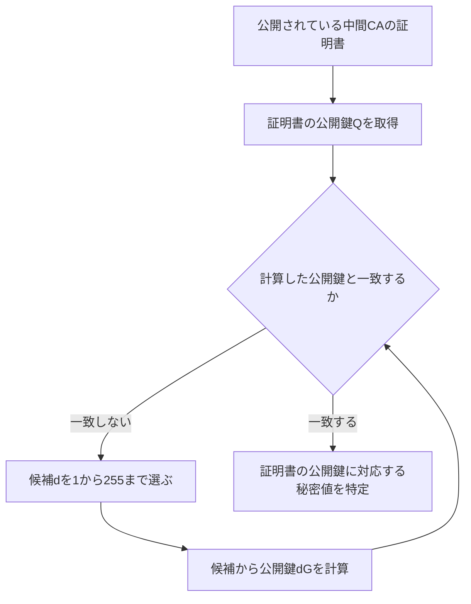
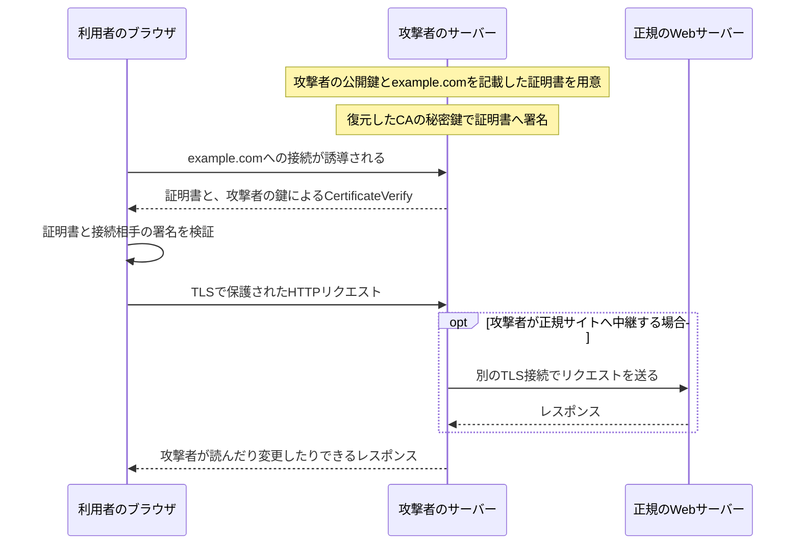
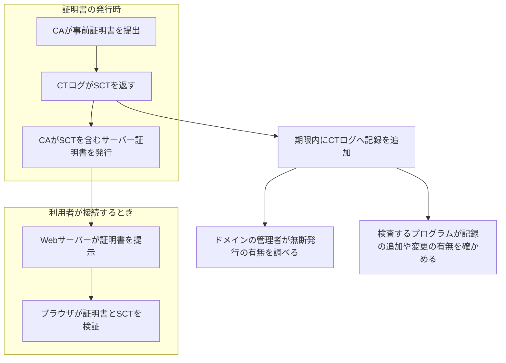
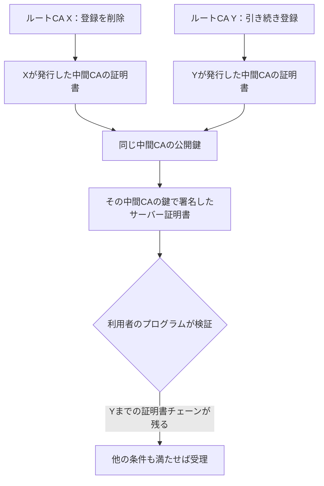

# eMudhraの事案から考える、TLSとWeb PKIの限界：補足資料

確認日：2026年11月12日。eMudhraの経緯は同社のFull Incident Reportと公開された調査記録、製品の動作は各製品の説明、プロトコルの動作はRFCに基づく。

## 目次

- [1. eMudhraで起きた問題と、報告書で説明されている範囲](#1-emudhraで起きた問題と報告書で説明されている範囲)
- [2. 小さな整数を秘密鍵にすると、なぜ公開鍵から特定できるのか](#2-小さな整数を秘密鍵にするとなぜ公開鍵から特定できるのか)
- [3. 証明書とTLSハンドシェイクで、それぞれ何を確認するのか](#3-証明書とtlsハンドシェイクでそれぞれ何を確認するのか)
- [4. CTログへの提出、SCTの検証、CTログの検査](#4-ctログへの提出sctの検証ctログの検査)
- [5. CAAが制限するものと、制限できないもの](#5-caaが制限するものと制限できないもの)
- [6. 証明書の失効と、クライアントによる拒否](#6-証明書の失効とクライアントによる拒否)
- [7. エンジニアが管理する対象と、事故時の確認手順](#7-エンジニアが管理する対象と事故時の確認手順)
- [8. ドメイン名の公開と、Web PKI以外の方法](#8-ドメイン名の公開とweb-pki以外の方法)
- [参照資料](#参照資料)

本編との対応は次のとおりである。

| 本編の論点 | 詳細を確認する節 |
| --- | --- |
| eMudhraで何が起きたか | 1、2 |
| CAの権限と、証明書を受理する条件 | 3 |
| CTとSCTの役割 | 4 |
| CAAの役割 | 5 |
| 利用者とエンジニアの対応 | 6、7 |
| 信頼の起点をどう選ぶか | 3.4、8.2 |

## 1. eMudhraで起きた問題と、報告書で説明されている範囲

### 1.1 復元された鍵と、追加で問題になった鍵

eMudhraはCAを運営する企業であり、企業そのものが一つの中間CAというわけではない。今回の対象には、同社が運営する複数の中間CAが含まれる。

秘密値が「4」などになっていたのは、ECDSAという電子署名方式を使う中間CAの秘密鍵である。RSAという別の電子署名方式を使う中間CAの秘密鍵にも、同じ試験中の取り扱いの問題があった。ただし、RSAの秘密鍵を公開鍵から容易に復元できたという報告ではない。[eMudhraの報告書、Summary][incident]

両者は、どちらも証明書などへ署名するための鍵である。次の表は、署名方式の違いと、今回報告された問題を対応させている。

| 中間CAが使う署名方式 | 問題になったこと | 公開情報からの秘密鍵の復元 |
| --- | --- | --- |
| ECDSA | 本来の秘密値の先頭1バイトが表す整数を、新しい鍵の秘密値として登録した | 可能だった |
| RSA | 秘密鍵の値をHSM外のPythonプロセスのメモリで扱い、定められた保護要件への適合を示せなかった | 容易に復元できたという報告ではない |

### 1.2 鍵の生成後に、弱い鍵が作られた

HSMは、秘密鍵の生成、保管、署名などを行う装置である。鍵をHSM内で保護したまま署名できる。鍵を別のHSMへ移す場合には、秘密鍵を暗号化して取り出す処理をwrap、暗号化された鍵を取り込む処理をunwrapと呼ぶ。

報告書によると、正常な鍵は最初にHSM内で生成されていた。その後の試験で、独自のPythonスクリプトが秘密値を読み出し、先頭1バイトが表す整数を秘密値とする鍵を登録した。これは、短い値を鍵導出関数へ入力して長い鍵を作ったという説明ではない。短い整数そのものが、証明書への署名に使うECDSAの秘密値になったという説明である。[報告書、Contributing Factor 1][incident]

### 1.3 署名が成功しても、正しい鍵を使っているとは限らない

弱い鍵でも、その鍵に対応する公開鍵が証明書に入っていれば、署名は正しく検証される。CSRは、証明書の発行を申請するため、公開鍵などの情報に申請者が署名したデータである。CSRの署名を検証しても、鍵の候補が十分に多いことまでは分からない。[RFC 2986、4節][csr]

今回の報告書では、似たラベルの鍵を取り違えたこと、生成した公開鍵と証明書の公開鍵を照合しなかったこと、以前のCRLの署名不一致を根本原因の調査につなげなかったことも挙げられている。CRLは、CAが署名して公開する証明書失効リストである。[報告書、Contributing Factors 2～4][incident]

### 1.4 発覚から報告書の公開まで

次の表は、鍵の復元の報告、失効、原因の説明を区別するための経緯である。日付は、公開記録に記載された日付に従う。

| 日付 | 公開記録から分かること |
| --- | --- |
| 2026年10月17日 | 第三者が秘密鍵の侵害を報告。Mozillaも独立に秘密鍵を復元し、Firefoxで拒否する対応を進めた。[Mozilla、Description][bug] |
| 10月18日 | eMudhraが対象のECDSAの中間CAの証明書を失効させた。[Mozilla、コメント1][bug-c1] |
| 10月30日 | Cloudflareが、復元された鍵を使った偽造証明書の観測を公表した。[Cloudflareの分析][cloudflare] |
| 11月7日 | eMudhraが、HSM外での取り扱いも問題になったRSAの中間CAの証明書を失効させた。[報告書、Summary][incident] |
| 11月9日 | 報告を共有するとした予定日を過ぎ、公開の催促を受けていた。[コメント73][bug-c73] [コメント78][bug-c78] |
| 11月11日の確認時点 | コメント82にFull Incident Reportが公開されている。[コメント82][incident] |

### 1.5 当事者の説明と、独立に確認された事実

秘密鍵を公開情報から復元できることは、報告者に加えてMozillaも独立に確認している。一方、スクリプトの処理や社内の判断の経緯は、当事者の報告書による説明である。Full Incident Reportが公開されたことと、独立レビューが完了したことは同義ではない。報告後も、スクリプトや当日の記録の公開、鍵をHSM外へ出す手順の承認などについて質問が続いている。[Mozilla、Description][bug] [コメント86以降][bug-c86]

## 2. 小さな整数を秘密鍵にすると、なぜ公開鍵から特定できるのか

### 2.1 ECDSAで使う秘密値と公開鍵の関係

ECDSAでは、秘密鍵に整数の秘密値を使い、その値から楕円曲線上の公開鍵を計算する。楕円曲線は、この計算に使う数学的な構造である。今回の鍵で使われていたP-384は、楕円曲線のパラメーターの名称である。[Cloudflareの分析][cloudflare] [RFC 5480、2.1節][ecc]

秘密値を `d`、規格で定められた基準点を `G`、公開鍵を `Q` とすると、関係は次の式で表される。

```text
Q = dG
```

右辺は、楕円曲線上で定義された演算により、基準点Gをd倍することを表す。秘密値dを知っていれば公開鍵Qを計算できるが、適切に選ばれたdをQから求めるのは計算上困難である。この非対称性を使う。

### 2.2 今回は、試す候補が少なかった

ところが、秘密値が256未満だと分かっていれば、有効な候補である1から255までを試せる。各候補から公開鍵を計算し、中間CAの証明書に記載された公開鍵と一致するかを比較すればよい。例えば秘密値が4なら、4を候補として計算した公開鍵が一致する。

次の図では、証明書の公開鍵と照合するまでを示す。攻撃者はCAへ問い合わせたり、秘密鍵のファイルを取得したりする必要がない。



特定された秘密値は、CAが署名に使う値と同じである。その値を使って作成した証明書の署名は、CAの公開鍵による検証に成功する。「秘密鍵のビット数を表す規格名が大きい」ことと、「実際に選ばれた秘密値を探し当てにくい」ことは別の条件である。[Cloudflareの分析][cloudflare]

## 3. 証明書とTLSハンドシェイクで、それぞれ何を確認するのか

### 3.1 CAの鍵とWebサーバーの鍵

ブラウザが証明書を使ってWebサーバーを確かめるとき、CAとWebサーバーは異なる秘密鍵を使う。CAは証明書へ署名し、Webサーバーはその証明書に記載された公開鍵に対応する秘密鍵を使って、TLSハンドシェイクで署名する。

次の表は、TLS 1.3でサーバー証明書を使う接続について、鍵と確認内容を対応させたものである。[RFC 8446、4.4.2～4.4.4節][tls]

| 鍵 | 秘密鍵を使う者と処理 | ブラウザが確認すること |
| --- | --- | --- |
| 中間CAの鍵 | CAがサーバー証明書へ署名する | 発行元CAの公開鍵で、証明書の署名を検証する |
| Webサーバーの鍵 | WebサーバーがCertificateVerifyメッセージへ署名する | 証明書の公開鍵で、接続相手の署名を検証する |
| 接続ごとに合意する鍵 | ブラウザとWebサーバーが、TLSの通信データを暗号化し、改ざんを検出する | 両者が同じ接続の鍵を使って通信できていることを確認する |

CertificateVerifyは、TLSハンドシェイクでそれまでに交換したメッセージなどに対する署名を送るメッセージである。証明書をコピーして提示するだけでは、証明書に対応する秘密鍵を持つことを証明できない。

### 3.2 CAの秘密鍵が復元された場合のなりすまし

攻撃者は、自分で作った公開鍵と秘密鍵のペアを使う。自分の公開鍵と `example.com` を記載した証明書に、復元したCAの秘密鍵で署名すれば、CertificateVerifyには自分の秘密鍵を使える。正規サイトの秘密鍵は必要ない。

次の図は、利用者が `example.com` へ接続しようとした通信を、攻撃者が自分のサーバーへ誘導できた場合を示している。証明書チェーン、ドメイン名、用途、有効期間、CTなどの条件も満たした場合に、ブラウザは攻撃者とのTLS接続を受け入れる。[Googleの説明][google]



この攻撃では、利用者と攻撃者の間の通信自体はTLSで暗号化されている。利用者が意図した相手とは異なる者が、その通信の終端になっている。

### 3.3 証明書の署名以外にも確認が必要である

証明書に有効なCAの署名があるだけで、どの接続にも使えるわけではない。ブラウザは、信頼するルートCAまでの証明書チェーン、接続先の名前、期限、用途、製品が要求するCTなどを確認する。

次の表は、検証の目的と参照する情報を対応させている。

| 確認すること | 参照する情報 | 対応する仕様 |
| --- | --- | --- |
| 信頼するCAまでつながるか | 各証明書の署名、CAとしての制約、登録済みのルート証明書 | RFC 5280、6節 |
| 接続しようとした相手の名前か | URLなどから決まる接続先の名前と、証明書のsubjectAltName拡張に記載された名前 | RFC 9525、6節 |
| 使用できる時刻と用途か | 証明書の有効期間、鍵の用途などの制約 | RFC 5280、4節と6節 |
| 公開を求める条件を満たすか | SCTと、ブラウザのCTポリシー | ChromeのCTポリシー |

subjectAltNameは、証明書が対象とするDNS名などを格納する拡張である。接続先のドメイン名の確認は、CAまでの証明書チェーンの検証とは別に必要になる。[RFC 5280][x509] [RFC 9525][names] [ChromeのCTポリシー][ct-policy]

### 3.4 ルートCAの自己署名を確認しても、信頼する理由は得られない

証明書の検証は、あらかじめ信頼すると決めた公開鍵などの情報から始める。この出発点を信頼アンカーと呼ぶ。Web PKIでは、OSやブラウザが採用したルートCAが通常この役割を担う。

ルート証明書が自身の秘密鍵で署名されていても、その署名だけでは、ルートCAを信頼してよい理由にはならない。誰でも自分の鍵で自己署名した証明書を作れるためである。RFC 5280の検証処理でも、信頼アンカーは検証に与える入力であり、その検証が新たに証明する結論ではない。[RFC 5280、6.1.1節][x509]

### 3.5 既に記録された通信を復号できるか

TLS 1.3では、接続ごとに一時的な鍵を使うDiffie–Hellman鍵共有を行える。楕円曲線を使う一時的なDiffie–Hellman鍵共有をECDHEと呼ぶ。この方式では、中間CAの秘密鍵だけを得ても、既に確立した接続の通信を復号する鍵は求められない。

今回のなりすましは、新しい接続で攻撃者を通信相手として受け入れさせる攻撃である。過去のTLS通信の復号とは、必要な条件が異なる。[RFC 8446、2節と付録E][tls]

## 4. CTログへの提出、SCTの検証、CTログの検査

### 4.1 CTに関わる処理は、接続時だけに行われるわけではない

CTはCertificate Transparencyの略で、証明書の情報を公開し、外部から調べられるようにする仕組みである。証明書の情報を記録して公開するサービスをCTログと呼ぶ。SCTはSigned Certificate Timestampの略で、提出された証明書の情報を定められた期限内にCTログへ追加するという、CTログを運営する組織の署名付きの約束である。

次の図では、証明書の発行、Webサイトへの接続、CTログを調べる作業を分けて示している。Webサーバーがブラウザから接続されるたびに、CAへSCTを求める処理はない。[CTの仕組み][ct-how]



### 4.2 CTログへ提出する証明書と、SCTの提示方法

CAが最終的な証明書へSCTを埋め込むには、証明書の発行前にSCTを取得する必要がある。そのため、発行予定の証明書のドメイン名や公開鍵などを含む、CTログへの提出専用の証明書を作る。これを事前証明書と呼ぶ。

事前証明書には、通常のTLS接続で証明書として使わせないための拡張が含まれる。CTログから返されたSCTは、CAが発行する最終的な証明書に埋め込まれる。事前証明書そのものを、Webサーバーが通常のサーバー証明書として提示するわけではない。[RFC 6962、3.1節][ct-v1]

完成した証明書をCTログへ提出する方法もある。次の表は、CTログへ提出する対象と、ブラウザへSCTを渡す方法を対応させたものである。

| CTログへ提出するもの | SCTをブラウザへ渡す方法 | 配備する情報 |
| --- | --- | --- |
| 事前証明書 | 最終的な証明書の拡張に埋め込む | SCTを含むサーバー証明書 |
| 完成したサーバー証明書 | TLS拡張で提示する | サーバー証明書と、その証明書に対するSCT |

TLS拡張は、TLSハンドシェイク中に追加の情報を交換する仕組みである。現在のChromeは、証明書内のSCTとTLSで提示されたSCTについて、それぞれ条件を定めている。以前は、サーバーがTLS接続中に提示するOCSP応答内のSCTも受け付けていたが、Chrome 148以降はこの方法を受け付けない。[ChromeのCTポリシー][ct-policy]

### 4.3 ブラウザは何を基準にSCTを受け入れるか

ChromeにはCTログの公開鍵を含む一覧が組み込まれており、SCTの署名をその公開鍵で検証する。SCTの署名の検証では、提示された証明書に対応する情報を使うため、別の証明書のSCTをそのまま流用することはできない。[RFC 6962、3.2節][ct-v1]

一覧は、Chromeの更新に加え、CTログの一覧を更新する機能でも配信される。更新されるのは、CTログの公開鍵や状態などを含む一覧である。[ChromeのCTログの一覧][ct-list]

署名が正しいSCTでも、それだけでChromeの条件を満たすとは限らない。Chromeは、CTログの状態、SCTを発行したCTログの数、運営する組織が異なるかを確認する。2026年11月12日のポリシーでは、証明書内に埋め込む方法は有効期間が180日以下なら二つ、180日超なら三つの異なるCTログからのSCTを必要とし、少なくとも二つは異なる組織が運営するCTログから取得する。[ChromeのCTポリシー、CT Compliant Certificates][ct-policy]

### 4.4 SCTが示す約束を、後から確かめる

SCTは、記録が既に公開されたことを必ず示すものではない。CTログへ記録する期限まで、未公開の時間が残っている場合がある。ブラウザはその期限まで接続を待たずにSCTを検証するため、約束どおり記録を追加したかを後から検査する作業が必要になる。

CTログは、記録をハッシュ値で階層的にまとめるMerkle treeというデータ構造を使う。ハッシュ値は、データから一定の手順で計算する固定長の値である。CTログを検査するプログラムは、CTログが署名した全体のハッシュ値と、一部のハッシュ値からなる検証用の情報を使って、記録の追加や過去の記録の維持を確かめる。[RFC 6962、2節、5.4節][ct-v1]

次の表は、同じCTログを調べる作業でも、目的と確認する対象が異なることを示している。

| 作業 | 誰が行うか | 確認する対象 |
| --- | --- | --- |
| 自社ドメイン名の証明書を探す | ドメインの管理者、または依頼を受けたサービス | 自社や委託先が申請していない証明書がないか |
| SCTに対応する記録の有無を検査する | CTログを検査するプログラムの運用者 | 期限後に、対象の記録がCTログへ追加されたか |
| 過去の記録の維持を検査する | CTログを検査するプログラムの運用者 | 以前の記録を削除、変更せずに新しい記録を追加したか |

この検査に使うデータは、一般にinclusion proof、consistency proofと呼ばれる。前者は記録がCTログに含まれること、後者は以前の記録を維持したままCTログが拡張されたことを確認するための情報である。CTログが相手ごとに異なる記録を示す問題まで発見するには、異なる相手が受け取った記録の要約を比較することも必要になる。[RFC 9162、2節と8節][ct-v2]

### 4.5 CTが不正発行を自動的に判定するわけではない

CTログは、ドメインの管理者が証明書の発行を許可したかを審査しない。攻撃者が有効なCAの署名を使って証明書を作れば、CTログの受け付け条件を満たしてSCTを取得できる場合がある。[RFC 6962、3節と7節][ct-v1]

今回の事案では、問題の中間CA配下のTLS証明書が対策前にCTログへ記録されていなかったため、必要なSCTを求めるクライアントは、それらの証明書を受け入れなかったとGoogleが説明している。ただし、攻撃者の証明書がCTの条件を満たした後は、ドメインの管理者側で発見し、失効などを求める作業が必要になる。[Googleの説明][google]

## 5. CAAが制限するものと、制限できないもの

### 5.1 DNSで、証明書の発行を許可するCAを指定する

CAAはCertification Authority Authorizationの略で、ドメインの管理者が、証明書の発行を許可するCAをDNSで指定する仕組みである。CAは発行前に、申請されたドメイン名についてCAAレコードを調べる。DNSレコードは、DNSで公開する名前と値の組である。

次の例では、`example.com` の通常の証明書の発行を `ca.example.net` で識別されるCAに許可する。`ca.example.net` は説明用の識別子であり、実際には利用するCAが指定する値を使う。

```dns
example.com. IN CAA 0 issue "ca.example.net"
```

`issue` は通常の証明書の発行許可を指定する項目である。ワイルドカード名の証明書には `issuewild` を使える。`issuewild` がなければ、ワイルドカード名についても `issue` の指定が適用される。複数の `issue` を置けば、複数のCAを許可できる。[RFC 8659、4節][caa]

### 5.2 CAAは、ブラウザが証明書の受理時に確認する承認ではない

CAAを確認して発行するかを決めるのはCAである。ブラウザが証明書を受け取るたびに、現在のCAAレコードを取得し、発行元CAと照合する仕組みではない。CAAを変更しても、既に発行された証明書は失効しない。[RFC 8659、5節と6節][caa]

そのため、CAAに従うCAの誤発行や、意図しないCAでの申請を減らす効果はあるが、CAが意図的にCAAを無視した場合や、CAの秘密鍵を得た攻撃者が証明書を作る場合には、それだけで発行を防げない。

### 5.3 CAの指定を、アカウントや確認方法まで限定する

CAAの拡張では、CAへの申請に使うアカウントや、ドメインを管理する権限の確認方法を指定できる。証明書の申請と発行を自動化するプロトコルをACMEと呼ぶ。拡張に対応するCAでは、ACMEのアカウントを指定する `accounturi` と、確認方法を指定する `validationmethods` を使える。[RFC 8657、3節と4節][caa-ext]

この指定も、CAが従うべき発行条件を細かくするものである。CAの秘密鍵で任意の証明書へ署名する能力を、暗号学的に取り除くものではない。

## 6. 証明書の失効と、クライアントによる拒否

### 6.1 失効を公表しても、署名そのものは検証できる

CAが証明書を失効させると、期限前であっても、その証明書を使うべきでないという情報が公開される。ただし、証明書のデータと署名は変わらない。クライアントが失効を知るか、別の拒否する設定を受け取らなければ、従来と同じ署名の検証に成功する。

失効情報を伝える代表的な方法は、CAが署名した失効リストを配布するCRLと、証明書の状態を問い合わせて署名付きの応答を得るOCSPである。OCSPはOnline Certificate Status Protocolの略である。[RFC 5280、5節][x509] [RFC 6960][ocsp]

### 6.2 同じ端末でも、製品ごとに必要な更新が異なる

証明書を検証するソフトウェア、参照するルート証明書の一覧、失効情報の扱いが異なれば、同じ端末でも対策の反映状況は変わる。今回のAppleの案内では、Appleの標準機能を使うSafariなどへの自動対応と、一部のコマンドラインツールに必要なOS更新を分けて説明している。[Appleの案内][apple]

Goも、標準ライブラリで証明書を検証する処理に修正を入れた。修正を稼働中のプログラムへ反映するには、修正済みのGoで再ビルドし、配備する必要がある。開発用PCのGoだけを更新しても、既に配備した実行ファイルは変わらない。[Goの説明][go]

### 6.3 ルート証明書を一つ削除しても、別の証明書チェーンが残る場合がある

同じ中間CAの公開鍵について、異なるCAが証明書を発行する場合がある。こうした証明書は、異なるルートCAまでの証明書チェーンを形成できる。今回もeMudhraとSectigoによる証明書が存在した。[Appleの案内][apple]

次の図では、ルートCA Xの証明書を削除しても、ルートCA Yを信頼していれば、同じ中間CAの公開鍵まで別の証明書チェーンが残ることを示している。



削除するルート証明書の名称だけでなく、問題の公開鍵を含む証明書が、ほかのルートCAまでつながらないかも確認する必要がある。

## 7. エンジニアが管理する対象と、事故時の確認手順

### 7.1 通信と証明書の管理作業を対応させる

自社サービスでは、利用者へ証明書を提示する処理と、外部サービスの証明書を検証する処理の両方が存在する。証明書の発行申請、DNSの設定、CTログに記録された証明書を調べる作業も、それぞれ担当者や設定が異なる。

次の表は、システムのどの箇所で、何を把握しておくかを示している。以下の管理項目は、今回の対策を自社システムへ反映するための実務上の提案である。

| 管理する対象 | 平常時に把握すること | CAの事故が起きたときの作業 |
| --- | --- | --- |
| 利用者からのTLS接続を受けるサーバー | 証明書、秘密鍵、配備先、交換方法、運用担当 | 対象の証明書を交換し、各配備先の提示内容を確認 |
| 外部APIへ接続する自社のプログラム | 接続先、証明書を検証するソフトウェア、参照するルート証明書、更新方法 | 必要な更新を適用し、問題の証明書を拒否することと正規の接続の成功を確認 |
| 自社ドメインのDNS | CAAで許可するCA、変更権限を持つ者、変更手順 | 証明書の交換先のCAを許可し、不要な許可や侵害を確認 |
| CAへ証明書を申請するアカウント | 申請できる者、認証方法、委託先の利用状況 | 無断の申請やアカウントへの侵害を確認 |
| CTログに追加された自社ドメイン名の証明書 | 調べるサービス、知らせる情報、受信者、証明書を照合する担当 | 申請していない証明書を調べ、発行元CAへ失効を依頼 |

### 7.2 証明書と外部APIへの接続を、別々に記録する

証明書を交換するときには、同じ証明書をどこへ配備しているかを把握する必要がある。外部APIへ接続するプログラムを更新するときには、そのプログラムが何を使って証明書を検証するかを把握する必要がある。記録する対象が異なるため、次の二つの一覧を用意する。

証明書については、少なくとも次の項目を記録する。

| 項目 | 記録する内容 |
| --- | --- |
| 証明書を識別する情報 | 証明書そのもの、発行元CA、シリアル番号 |
| 対象の名前 | 証明書に記載されたすべてのドメイン名 |
| 使用できる期間 | 開始日時と終了日時 |
| 配備先 | Webサーバー、ロードバランサーなど、実際に証明書を提示するすべての箇所 |
| 秘密鍵の保管先 | HSM、サービスの鍵管理機能、ファイルなどの保管方法とアクセス権限 |
| 申請の経緯 | 自社または委託先の申請者、利用したCAのアカウント |
| 交換の担当と手順 | 発行申請、配備、反映に必要な操作、接続確認を行う者 |

シリアル番号は、発行元CAが証明書に付ける識別番号である。異なるCAでは同じ番号が使われる場合があるため、発行元CAと組み合わせて扱う。[RFC 5280、4.1.2.2節][x509]

外部APIへの接続については、次の項目を記録する。

| 項目 | 記録する内容 |
| --- | --- |
| 呼び出すプログラム | サービス、定期実行するプログラム、その実行環境 |
| 接続先 | APIのドメイン名、用途、接続先の運用担当への連絡方法 |
| 証明書を検証する処理 | OSの機能か、Node.jsなどの実行環境か、組み込んだライブラリか |
| 参照するルート証明書 | OSが配布する一覧か、プログラムが同梱する一覧か、独自に指定した一覧か |
| 更新方法 | 更新するパッケージ、再ビルド、再配備、再起動の要否 |
| 更新の確認 | 稼働しているバージョンと、問題の証明書を拒否することの確認方法 |

### 7.3 CTログから申請していない証明書が見つかった場合

証明書が見つかっただけでは、不正発行とは断定できない。委託先、クラウドの証明書管理機能、通常の更新処理による発行かを確認する。

1. 見つかった証明書または事前証明書と、発見したCTログ、発見日時を保存する。
2. 保管している証明書、CAへの申請記録、委託先の申請内容と照合する。
3. 自社や委託先が申請していなければ、発行元CAへ調査と失効を求める。
4. DNSの設定やCAへ申請するアカウントについて、無断の変更や利用を調べる。
5. 発行元CAの対応が得られない場合などは、ルート証明書ストアを管理するベンダーや組織への報告も検討する。

CTログに追加された証明書の情報を知らせるサービスを使う場合も、この確認と依頼を自社側で行う者を決めておく。[CTの仕組み][ct-how]

### 7.4 接続障害が起きた場合

正規の証明書も、CAの事故を理由に拒否される場合がある。まず、接続先の証明書の問題なのか、自社のプログラムへ対策が反映されていない問題なのかを確認する。

| 調べる順序 | 確認すること | 結果に応じた対応 |
| --- | --- | --- |
| 1 | どのプログラムから、どのドメイン名への接続が失敗したか | 実際に失敗する実行環境とバージョンを特定 |
| 2 | 接続先が提示する証明書と中間CAの証明書 | 期限、対象の名前、事故の対象CAを確認 |
| 3 | そのプログラムが参照するルート証明書と、証明書を検証するソフトウェア | 製品の案内に従い、必要な更新を適用 |
| 4 | 接続先が対策後も受理される証明書へ交換したか | 未交換なら、接続先の運用担当へ交換を求める |
| 5 | 更新後に正規の接続と、不正な証明書の拒否を確認できたか | 稼働環境での確認結果を残す |

証明書の検証を無効にすると、相手が正しいドメインのサーバーであることを確認できなくなる。障害の回避策として検証を無効にするのではなく、証明書の交換と検証するソフトウェアの更新で解消する。[Cloudflareの開発者向け案内][cloudflare-action]

### 7.5 OpenSSLで提示された証明書を確認する

OpenSSLは、TLS接続や証明書を扱うライブラリとコマンドを提供する。`s_client` はTLS接続を試すコマンドである。次の例は、`example.com` が提示する証明書を表示し、ドメイン名も検証する。

```sh
openssl s_client -connect example.com:443 -servername example.com -showcerts -verify_hostname example.com -verify_return_error
```

`-servername` は、サーバーへ接続先の名前を通知する指定である。`-verify_hostname` は、証明書がそのドメイン名を対象とするかを検証する指定である。両者は役割が異なる。`-verify_return_error` は、証明書の検証に失敗したときに、エラーのまま接続を続行させないための指定である。[OpenSSL s_client][openssl-client]

`-showcerts` が表示するのは、サーバーが送った証明書の一覧である。表示された一覧そのものが、検証済みの証明書チェーンという意味ではない。また、OpenSSLの検証に成功しても、ブラウザのCTポリシーや製品固有の拒否する設定まで満たしたとは判断できない。

保存したサーバー証明書を `server.pem` とすると、内容は次のコマンドで表示できる。PEMは、証明書などのデータを文字列として格納する形式である。

```sh
openssl x509 -in server.pem -noout -text
```

発行元、有効期間、対象のドメイン名、公開鍵、拡張の内容を確認する。これも内容の表示であり、信頼するルートCAまでの証明書チェーンを検証する処理ではない。[OpenSSL x509][openssl-x509]

### 7.6 証明書の再発行と配備を自動化する

ACMEは、CAへの証明書の申請と、申請者がドメインを管理する権限を確認する処理を自動化するプロトコルである。指定された内容をWebサーバーから返す方法や、DNSへ指定された値を設定する方法などがある。[RFC 8555、7節と8節][acme]

ただし、CAから証明書を取得するだけでは、サービスの交換は完了しない。配備先への反映、必要な再読み込み、利用者が受け取る証明書の確認まで自動化し、失敗した場合に運用担当へ知らせる必要がある。

ACMEの拡張であるARIは、CAが更新を試みる期間をクライアントへ知らせる仕組みである。ARIはACME Renewal Informationの略で、通常より早い交換を促す用途にも使える。利用するCAとクライアントが対応している必要があり、受け取った更新情報を処理した後の配備も必要である。[RFC 9773、概要と4節][ari]

## 8. ドメイン名の公開と、Web PKI以外の方法

### 8.1 DNSで名前を引けることと、すべての名前を列挙できること

DNSは、問い合わせた名前について、そのIPアドレスなどの情報を返す。`admin.example.com` という名前を知らない者が、通常の問い合わせだけで `example.com` 配下の名前をすべて取得できるわけではない。[RFC 1034、3節と4節][dns]

DNSのゾーン内のデータをまとめて転送するAXFRという仕組みはあるが、名前を引く通常の問い合わせとは異なる。ゾーンは、DNSの管理権限を持つ範囲のデータである。AXFRを誰へ許可するかは、DNSサーバー側で制限できる。[RFC 5936、5節][axfr]

一方、公開Web用の証明書に `admin.example.com` と記載し、その情報がCTログへ追加されれば、第三者はCTログから名前を知ることができる。CTログがドメイン名を公開することは、「証明書に記載した名前を秘密として扱えない」理由になる。ただし、`*.example.com` というワイルドカード名の証明書から、個別のサブドメイン名をすべて取得できるわけではない。[Chromeの説明、Domain Privacy][ct-sites]

### 8.2 DNSで公開鍵との対応を示すDANE

ドメインの管理者が、DNSへ公開鍵や証明書との対応を公開する方法もある。DNSの応答の出所と改ざんの有無を署名で確認する仕組みをDNSSECと呼ぶ。DNSSECも、あらかじめ信頼する鍵から署名を検証する。[RFC 4033、3節と4節][dnssec]

DANEは、DNSSECで検証できるTLSAレコードを使い、TLSで使う証明書や公開鍵との対応を示す仕組みである。TLSAは、その対応を格納するDNSレコードの種類である。使うには接続するプログラムの対応が必要で、Web PKIのCAへの信頼に代えて、DNSSECの署名を検証するための信頼の起点が必要になる。[RFC 6698、概要と2節][dane]

### 8.3 自社で両端を管理する通信

自社が通信するプログラムとサーバーの両方を管理できる場合は、信頼するCAを自社の専用CAへ限定する設計を選べる。公開CAの秘密鍵が侵害されても、そのCAからの証明書チェーンを信頼しない設定であれば、その公開CAの証明書は受理されない。

この設計では、専用CAの鍵の保護、ルート証明書の配布、鍵の交換、古い設定が残ったプログラムへの対応を、自社が担う必要がある。信頼する組織を限定することと、その組織の鍵と設定を維持する責務は、一緒に引き受けることになる。[RFC 5280、6.1.1節][x509]

## 参照資料

### eMudhraの事案と各製品の説明

- [Mozilla Bug 2083449][bug]。最初の報告と独立した復元の確認。
- [eMudhra Full Incident Report、コメント82][incident]。原因、対象、失効、改善項目についての当事者の報告。
- [報告書公開後の質問、コメント86以降][bug-c86]。独立した確認に向けた追加質問。
- [Cloudflareによる技術分析と観測][cloudflare]。小さい秘密値と偽造証明書の観測。
- [GoogleによるChromeとAndroidの対策][google]。CTによる保護と製品の対応。
- [Appleによる対策の説明][apple]。標準機能とコマンドラインツールの対応、複数の証明書チェーン。
- [Goによる対策の説明][go]。証明書を検証する処理の修正。
- [Cloudflareの開発者向け案内][cloudflare-action]。外部サービスへ接続するプログラムの対応。

### 証明書、TLS、CT、DNSの仕様

- [RFC 2986][csr]：CSRの形式。
- [RFC 5480][ecc]：楕円曲線暗号の公開鍵と証明書への格納。
- [RFC 5280][x509]：証明書、CRL、証明書チェーンの検証。
- [RFC 9525][names]：TLSで使う接続先の名前の検証。
- [RFC 8446][tls]：TLS 1.3。
- [RFC 6960][ocsp]：OCSP。
- [RFC 6962][ct-v1]：CT v1の事前証明書、SCT、CTログの検査。
- [RFC 9162][ct-v2]：CT v2。RFC 6962の後続仕様。後続仕様の存在だけをもって、現在のブラウザが同じ形式を採用しているとは判断できない。
- [ChromeのCTポリシー][ct-policy]：ブラウザがSCTを受理する条件。
- [ChromeのCTログの一覧][ct-list]：公開鍵を含む一覧の形式と配布。
- [CTの仕組み][ct-how]：CTログ、ブラウザ、証明書を調べるサービスの関係。
- [ChromeのWebサイト運用者向け説明][ct-sites]：SCTの配備とドメイン名の公開。
- [RFC 8659][caa]：CAA。
- [RFC 8657][caa-ext]：CAAのアカウントと確認方法の指定。
- [RFC 8555][acme]：ACME。
- [RFC 9773][ari]：ACMEの更新情報。
- [RFC 1034][dns]：DNSの問い合わせと管理の構造。
- [RFC 5936][axfr]：DNSのゾーン転送。
- [RFC 4033][dnssec]：DNSSECが提供する検証とその範囲。
- [RFC 6698][dane]：DANEとTLSAレコード。
- [OpenSSL s_client][openssl-client]、[OpenSSL x509][openssl-x509]：確認用コマンド。

[incident]: https://bugzilla.mozilla.org/show_bug.cgi?id=2083449#c82
[bug]: https://bugzilla.mozilla.org/show_bug.cgi?id=2083449
[bug-c1]: https://bugzilla.mozilla.org/show_bug.cgi?id=2083449#c1
[bug-c73]: https://bugzilla.mozilla.org/show_bug.cgi?id=2083449#c73
[bug-c78]: https://bugzilla.mozilla.org/show_bug.cgi?id=2083449#c78
[bug-c86]: https://bugzilla.mozilla.org/show_bug.cgi?id=2083449#c86
[cloudflare]: https://blog.cloudflare.com/emudhra-patching
[google]: https://blog.google/security/protecting-chrome-and-android-users-from-compromised-emudhra-intermediate-ca-certificates/
[apple]: https://support.apple.com/en-us/149555
[go]: https://go.dev/blog/emudhra-incident
[cloudflare-action]: https://blog.cloudflare.com/emudhra-certificate-compromise/
[csr]: https://www.rfc-editor.org/rfc/rfc2986.html
[ecc]: https://www.rfc-editor.org/rfc/rfc5480.html
[x509]: https://www.rfc-editor.org/rfc/rfc5280.html
[names]: https://www.rfc-editor.org/rfc/rfc9525.html
[tls]: https://www.rfc-editor.org/rfc/rfc8446.html
[ocsp]: https://www.rfc-editor.org/rfc/rfc6960.html
[ct-v1]: https://www.rfc-editor.org/rfc/rfc6962.html
[ct-v2]: https://www.rfc-editor.org/rfc/rfc9162.html
[ct-policy]: https://googlechrome.github.io/CertificateTransparency/ct_policy.html
[ct-list]: https://googlechrome.github.io/CertificateTransparency/log_lists.html
[ct-how]: https://certificate.transparency.dev/howctworks/
[ct-sites]: https://googlechrome.github.io/CertificateTransparency/site_operators.html
[caa]: https://www.rfc-editor.org/rfc/rfc8659.html
[caa-ext]: https://www.rfc-editor.org/rfc/rfc8657.html
[acme]: https://www.rfc-editor.org/rfc/rfc8555.html
[ari]: https://www.rfc-editor.org/rfc/rfc9773.html
[dns]: https://www.rfc-editor.org/rfc/rfc1034.html
[axfr]: https://www.rfc-editor.org/rfc/rfc5936.html
[dnssec]: https://www.rfc-editor.org/rfc/rfc4033.html
[dane]: https://www.rfc-editor.org/rfc/rfc6698.html
[openssl-client]: https://docs.openssl.org/3.6/man1/openssl-s_client/
[openssl-x509]: https://docs.openssl.org/3.6/man1/openssl-x509/
