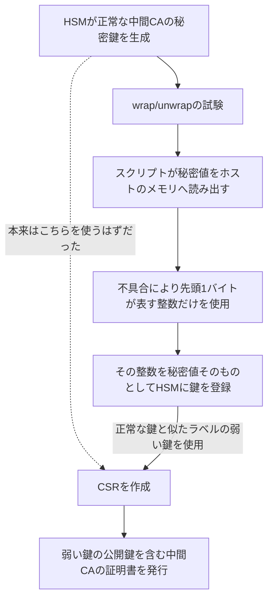
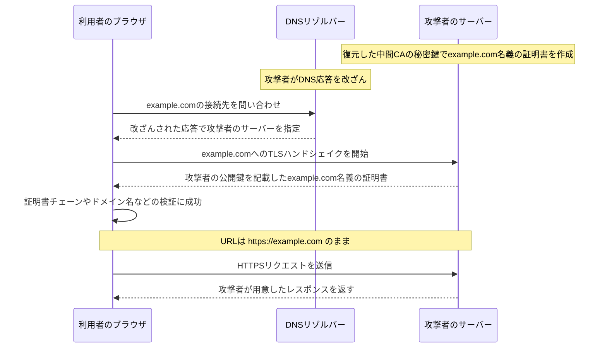
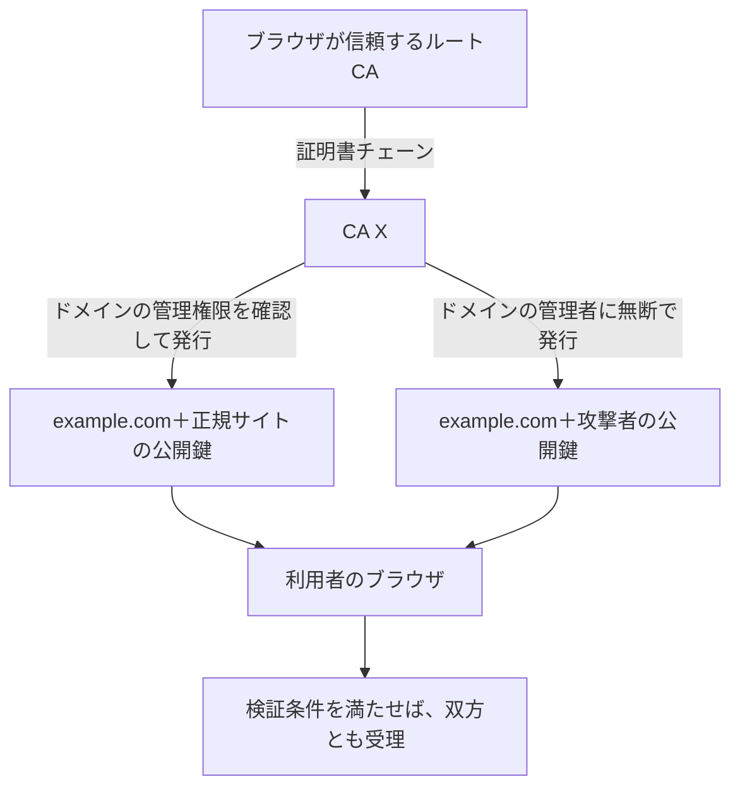
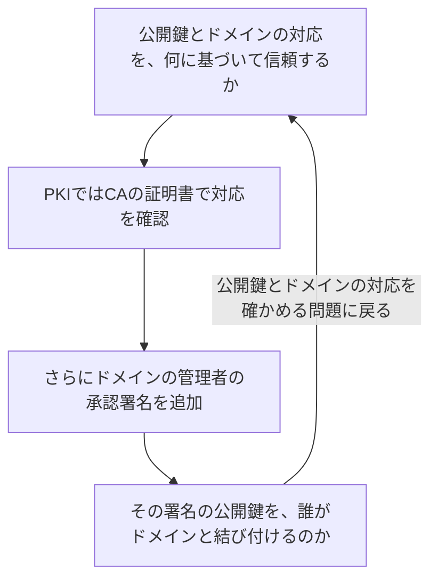
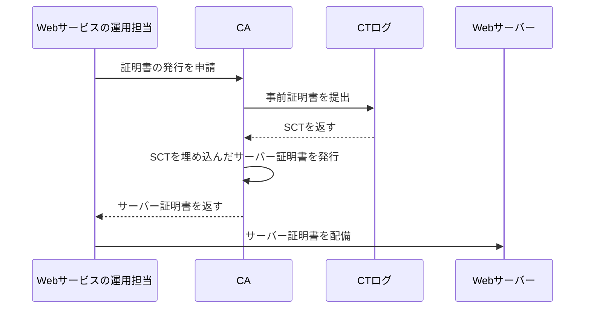
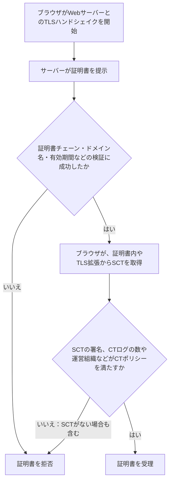
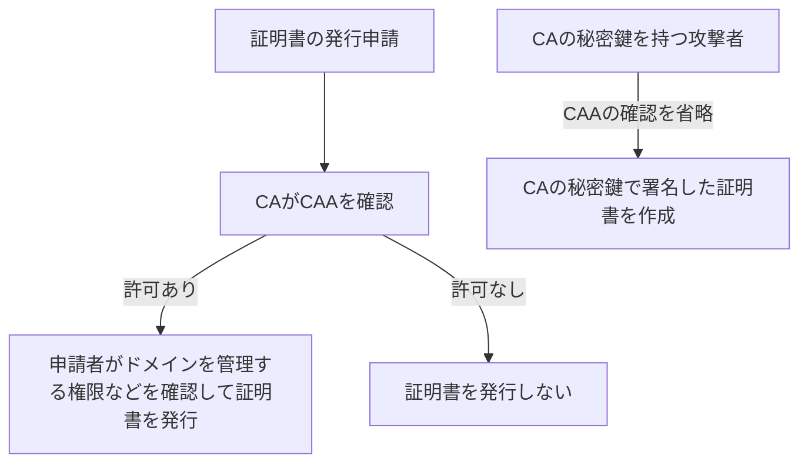
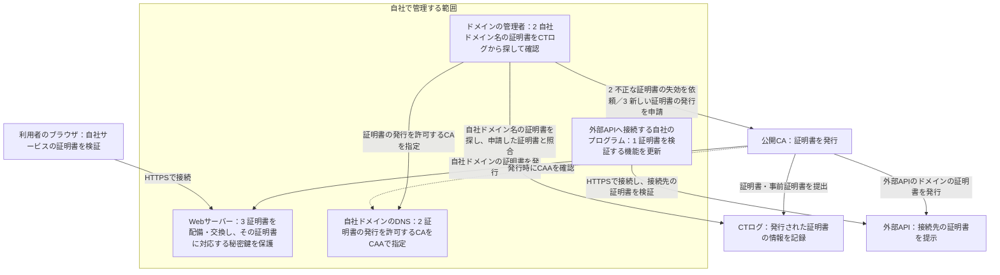
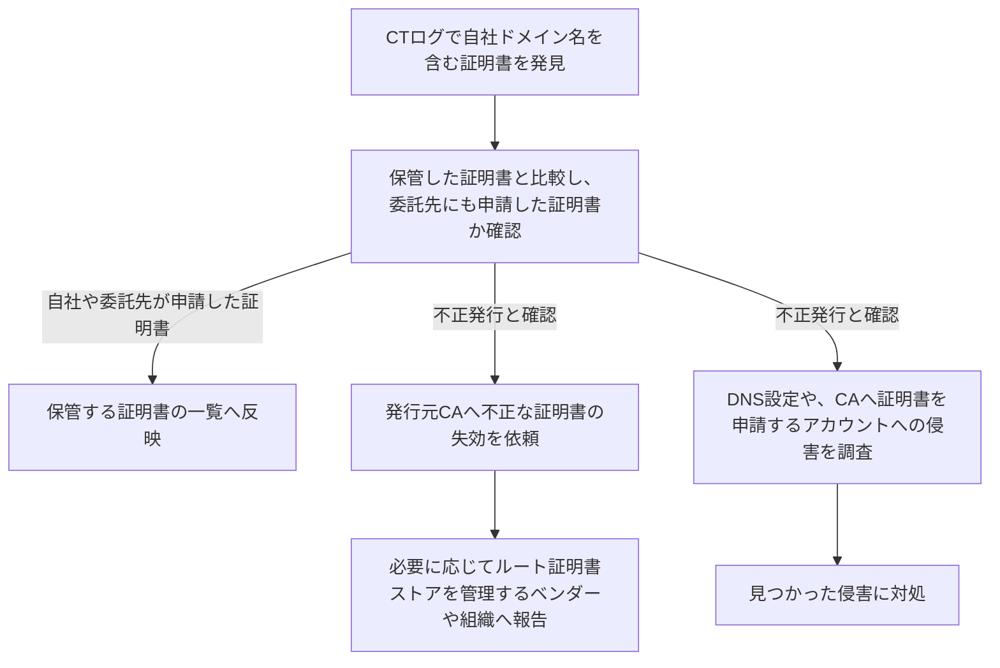
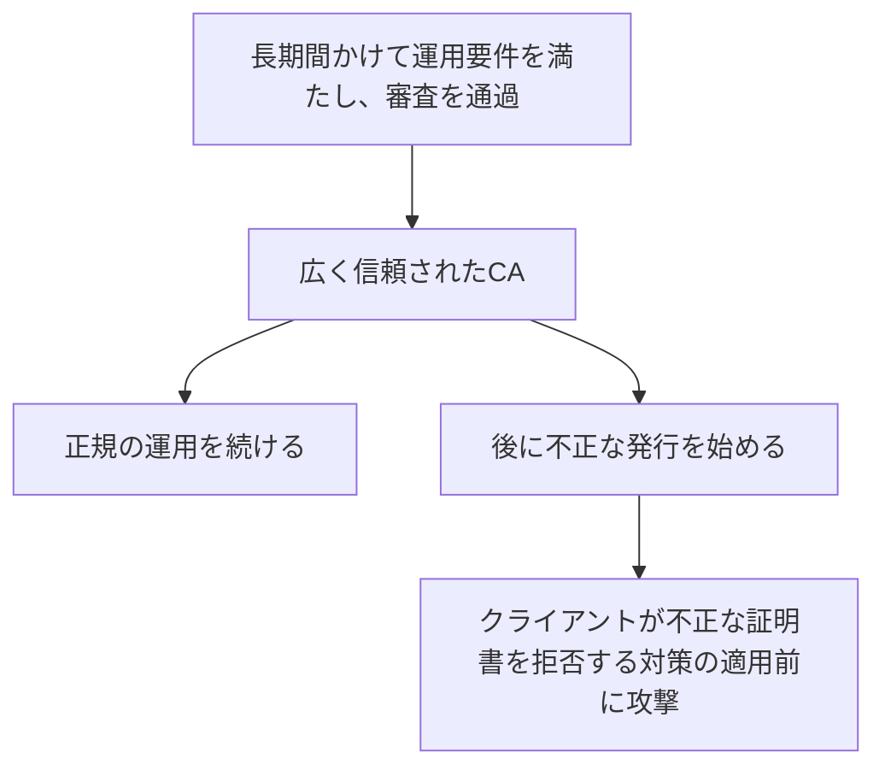

# eMudhraの事案から考える、TLSとWeb PKIの限界

今回は、eMudhraが運営する中間CAの秘密鍵が公開情報から復元できた件を取り上げる。「秘密鍵が4だった」という話を見かけた方もいると思う。私には、同時期のPHPの話題に隠れていた印象があるが、他人のサイトになりすます証明書を誰でも作れる状態になっていたという点で、こちらのほうが深刻な問題だと感じた。[Cloudflareの分析][S3]

まずeMudhraで何が起きたかを振り返り、そこからWeb PKIがCAへの信頼にどこまで依存しているのかを確認する。そのうえで、CTやSCT、CAAによる対策を説明し、ユーザーとして何を知っておくべきか、エンジニアとして何をすべきかを考える。

## 1. eMudhraで何が起きたのか

### 中間CAの秘密鍵を復元できると報告された

eMudhraは、ルートCAと、その配下でサーバー証明書などを発行する中間CAを運営する企業である。2026年10月に復元できると報告されたのは、同社が運営する中間CAが、ECDSAという方式で証明書へ署名するための秘密鍵だった。第三者もそのCAの有効な署名を持つ証明書を、任意のドメイン名に対して作成できる状態だった。[Mozilla][S1] [Google][S2] [報告書・概要][S4c82]

### 小さな整数を秘密鍵に使っていた

問題の中間CAは、秘密鍵に「4」などのごく小さな整数を使っていた。そのため、公開されている中間CAの証明書の公開鍵から、対応する秘密鍵を容易に特定できた。[Mozillaの調査、コメント5][S4c5]

通常、公開鍵から秘密鍵を求めることは計算上困難である。しかし、小さな整数から順に秘密鍵の候補を試せばよい場合は、各候補から公開鍵を計算し、証明書の公開鍵と一致するかを短時間で確かめられる。[Cloudflareの分析][S3]

### 先頭1バイトの整数を秘密値としてHSMへ登録した

では、なぜそのような鍵が使われたのか。同社のインシデントレポートによると、別メーカーのHSMへ鍵を移す準備として、2025年4月30日に、鍵を暗号化して取り出し、再び取り込むwrap/unwrapの試験を行っていた。HSMは、秘密鍵を生成・保管し、署名などの処理を行う装置である。[報告書・原因分析][S4c82]

HSMが最初に生成した鍵は正常だった。しかし、Pythonスクリプトの不具合により、HSMから読み出した秘密値を表すバイト列のうち、先頭の1バイトが表す整数を、新たな鍵の秘密値そのものとしてHSMへ登録した。このため、登録された鍵の秘密値は256未満になった。正常な鍵と弱い鍵のラベルが似ており、弱い鍵で証明書の発行申請であるCSRを作成し、その公開鍵を含む中間CAの証明書が発行された。[報告書・原因分析][S4c82]

下図は、正常な鍵を生成した後の処理で弱い鍵が作られ、その鍵に対して証明書が発行された経緯を示している。



同社は、生成した鍵と証明書の公開鍵が対応するかを照合せず、鍵の強度も検査していなかった。2025年5～6月には、正常な鍵で署名した証明書失効リストであるCRLを、中間CAの証明書の公開鍵で検証できない問題も起きた。しかし、弱い鍵で署名し直して解決とし、鍵が食い違う原因を調べていなかった。[報告書・原因分析][S4c82]

### RSAを使う中間CAの秘密鍵は、HSM外での保護が問題になった

同じ試験では、ECDSAに加え、RSAという別の方式で証明書へ署名する中間CAの秘密鍵も扱っていた。これらのRSAの秘密鍵には、先ほどのような秘密値の切り詰めは起きていなかった。しかし、秘密鍵をHSM外へ読み出し、Pythonプロセスのメモリで扱っていた。同社は、証明書運用規定であるCPSに従った鍵の保護を示せないとして、対応する中間CAの証明書も11月7日に失効させた。RSAの秘密鍵も公開情報から復元できたという報告ではない。[報告書・概要と影響][S4c82]

### HSM外で秘密鍵を扱ったことと、それを見逃した運用が問題である

問題は、スクリプトの不具合で秘密値が小さくなったことにとどまらない。HSMを使えば、秘密鍵を装置内で保護したまま署名を行える。しかし今回の処理では、秘密鍵の値をHSM外のPythonプロセスで扱っていた。秘密鍵を暗号化した状態で移すことと、プログラムが秘密値を直接読み書きすることは異なる。後者では、ホスト側のメモリやプログラムも秘密鍵を保護しなければならない。HSMの内部で鍵を保護する設計を採りながら、その外で秘密値を扱う手順を承認していた点が、まず問題である。[報告書・原因分析][S4c82] [CA秘密鍵の保護要件][S9]

eMudhraのルートCAを登録したブラウザやOSは、そのルートCAを信頼の起点として証明書を検証していた。eMudhraは、Webの通信相手を確かめる仕組みを支える事業者として、その信頼に見合う鍵管理を行う責務を負っている。鍵を保護する手順を設け、手順が正しく機能していることを監査で確かめるのは、その責務を果たすためである。[Jxck氏の記事「信頼の破綻」][S27]

それにもかかわらず、同社はHSM外で秘密値を扱う処理を承認し、弱い鍵への証明書発行を見逃し、CRLの署名不一致が起きても原因を突き止めなかった。私は、これを単なるプログラムのバグとして評価することはできないと考える。信頼の起点を担うCAを運営する組織として、果たすべき責務を果たしていなかったという問題である。[報告書・原因分析][S4c82]

### 報告書は予定日を過ぎて公開され、独立レビューは継続している

同社は11月9日に報告を共有するとしていたが、予定日に公開せず、提出を催促されていた。11月11日の確認時点では、Bugzillaのコメント82にFull Incident Reportが公開されている。ただし、独立レビューは継続中で、関連する改善項目の期限は12月4日とされている。[コメント73][S4c73] [コメント78][S4c78] [報告書・対応項目][S4c82]

### 攻撃者のサーバーが正規サイトとして受け入れられる条件

攻撃者は、自分の公開鍵と他人のドメイン名を記載した証明書を作成し、復元した中間CAの秘密鍵で署名できる。この署名は、中間CAの公開鍵で正しく検証される。

例えば、利用者が `https://example.com` へアクセスしようとしたとする。攻撃者がDNS応答や通信経路を操作して、その通信を自分のサーバーへ誘導し、`example.com` 名義の不正な証明書を提示する。提示された証明書が、信頼するルートCAからの証明書チェーン、ドメイン名、有効期間、用途、CTなどについて、ブラウザの検証をすべて通過すると、攻撃者のサーバーとのTLS接続が成立する。URLは `https://example.com` のままでも、攻撃者は利用者が送受信する内容を読み取ったり、書き換えたりできる。[Google][S2] [Mozilla][S1][^impact]

次の図は、DNS応答を操作して利用者を攻撃者のサーバーへ誘導する場合を示している。



この攻撃では、攻撃者自身の鍵ペアでTLSハンドシェイクを行うため、正規サイトの秘密鍵が侵害されていなくても、なりすましが成立する。

### ブラウザやOS、Node.jsなどで証明書を拒否する対策が配布された

なりすましへの対策には、問題の中間CAの秘密鍵で署名された証明書を、ブラウザやアプリケーションに拒否させる必要がある。

今回の中間CAには、eMudhraに加え、別の認証局であるSectigoも証明書を発行していた。同じ中間CAの公開鍵に対して二つの証明書があり、それぞれ異なるルートCAへつながる証明書チェーンがあった。[Apple][S20] 両社は対象の中間CAの証明書を失効させたが、すべてのクライアントが失効情報を取得して拒否するわけではない。そのため、各製品でも証明書を拒否するための情報の配信やソフトウェアの更新が行われた。[Mozilla][S1] [Go][S6]

端末は、登録済みのルート証明書を信頼の起点として、問題の中間CAを経由する証明書チェーンを検証していた。対策には、その中間CAを明示的に拒否する方法と、証明書チェーンの検証に使うルート証明書を削除する方法がある。

次の表は、代表的な製品で配布された対策と、利用側で確認すべき更新対象をまとめたものである。Linuxについては、ディストリビューションの例としてUbuntuを挙げる。

| 製品・環境 | 配布された対策 | 利用側で確認すること |
| --- | --- | --- |
| Chrome・Android | Chromeは、問題の中間CAの公開鍵を使う証明書を拒否する情報を配信。AndroidにもGoogle Play開発者サービス経由で対策を配信 | ブラウザや端末に対策が届いているか。[Google][S2] |
| Firefox | 問題の中間CAの証明書を拒否する情報を自動配信し、Firefoxと証明書の検証に使うライブラリも更新 | 自動配信と製品更新の適用状況。[Mozilla][S1] |
| iPhone・Macなど | Appleの証明書設定データで、問題の中間CAと関連するルートCAの証明書を自動的に拒否 | Safariなどには自動適用。Macの一部のコマンドラインツールや独自のルート証明書の一覧を持つアプリは別途確認する。[Apple][S20] |
| Windows・Edge・WebView2 | Windowsと、Edge・WebView2に証明書の拒否情報を配信。関連するルートCAなどを削除する更新も配布 | Windowsの証明書一覧・OS更新と、ブラウザの証明書拒否情報の更新の双方。[Microsoft][S21] |
| Node.js | 22・24・26系に、問題の公開鍵を含む証明書チェーンを拒否する修正などを配布 | 修正版のNode.jsへの更新とプロセスの再起動、コンテナなどへの再配備。[Node.js][S22] [24系の変更内容][S25] |
| Ubuntu | ルート証明書の一覧を配布する `ca-certificates` パッケージを更新し、関連するルート証明書を削除 | OSとコンテナ内の証明書パッケージ。削除対象はUbuntuのリリースによって異なる。[USN-8944-1][S23] [USN-8944-2][S24] |
| Go製アプリケーション | 標準ライブラリの証明書の検証処理に、問題の中間CAを拒否する修正を追加 | 修正済みGoでアプリケーションを再ビルドし、配備する。[Go][S6] |

自社サービスのサーバーから外部APIへ接続するときも、そのサーバー側で接続先の証明書を検証する。利用者のブラウザへの対策とは別に、サーバーで使うOSやプログラムにも対策が反映されたかを確認する必要がある。

## 2. なぜ一つのCAの問題に、世界中が対応しなければならないのか

eMudhraが不適切な鍵を使ったことは、まず同社の運用上の失敗である。しかし、なぜ一つのCAの失敗に対して、世界中のサイトやアプリケーションまで対応しなければならないのか。それは、CAが持つ証明書の発行権限が、広い範囲のドメインに及ぶためである。

### CAは、ドメインの管理者からの承認なしに有効な証明書を作成できる

CAは、ドメインの管理者の承認がなくても、任意のドメイン名を記載した証明書を作成し、署名できる。[^constraints]

もちろん、CAの運用ルールは、証明書の申請者がそのドメインを管理していることの確認を義務付けている。DNSへ指定の値を設定させたり、Webサーバーから指定の応答を返させたりするのは、この確認のためである。無断で発行しないという制約は、CAがこうしたルールを守ることで成り立っている。[Baseline Requirements][S9]

ブラウザは、自身が信頼するルートCAまでの証明書チェーンと署名を検証し、ドメイン名、有効期間、用途、後述するCTについてブラウザが定める条件なども確認する。これらの検証に成功すれば、証明書を受理する。ドメインの管理者が発行を許可したかどうかを、別に確認しているわけではない。[RFC 5280の6節][S8]

例えば、CA Xは、`example.com` と正規サイトの公開鍵を記載した証明書を発行する一方で、ドメインの管理者に無断で、同じドメイン名と攻撃者の公開鍵を記載した証明書も発行できる。下図は、同じCAが発行した両方の証明書が、ブラウザの検証を通る場合を示している。



また、第三者がCAの秘密鍵を盗んだり、今回のように復元したりすれば、CAの発行システムを使わずに証明書を作成できる。CA自身が運用ルールを守っていても、秘密鍵を得た攻撃者による発行は防げない。

### ドメインの管理者が証明書に署名すれば解決するか

CAが発行した証明書について、ドメインの管理者が発行を許可したことも確認できるようにしたいとする。例えば、ドメインの管理者が持つ別の秘密鍵で、その証明書に追加の署名を行うのはどうだろうか。

この署名を検証するには、ドメインの管理者の公開鍵が必要である。しかし、取得した公開鍵が本当にそのドメインの管理者のものかは、別に確かめなければならない。そして、公開鍵とドメインの対応を信頼できる方法で確かめることは、まさしくPKIが解決している問題である。下図のように、承認の署名を追加しても、同じ問題に戻ってしまう。



署名の検証を重ねるだけでは、公開鍵とドメインの対応を信頼する出発点は得られない。Web PKIでは、その出発点として、OSやブラウザなどに登録されたルートCAをあらかじめ信頼している。このような検証の出発点を、信頼アンカーと呼ぶ。ルートCAを信頼する判断自体は、その証明書の署名から導かれるものではなく、採用審査や運用要件などに基づいて行われる。[RFC 5280の6節][S8] [Baseline Requirements][S9]

事前の鍵共有やDNSSECを使う方法もあるが、その場合も、共有した鍵やDNSSECの信頼アンカーをあらかじめ信頼する必要がある。[^dane]

## 3. CTで証明書の発行を公開し、監視する

CAが不正な証明書を発行しても、その証明書の情報が公開されていれば、ドメインの管理者が発見できる。Certificate Transparency、CTは、発行された証明書の情報を公開し、誰でも調べられるようにする仕組みである。証明書に記載されたドメイン名や公開鍵、発行元などの情報を記録して公開するサービスを、CTログと呼ぶ。CTログは複数の組織がそれぞれ運営している。ただし、CTログは、ドメインの管理者が発行を許可したかを審査するものではない。[RFC 6962の1節][S10]

### ドメインの管理者が、自分のドメイン名を含む証明書の発行を監視する

ドメインの管理者は、CTログから自分のドメイン名を含む証明書を探し、自社や委託先が申請した証明書かを確かめる必要がある。自分で継続的に調べるほか、指定したドメイン名を含む証明書がCTログへ追加されると、その証明書の情報をメールなどで知らせるサービスを利用する方法もある。

不正発行と分かった場合は、発行元CAへ失効を求め、必要に応じて、ブラウザやOSのルート証明書ストアを管理するベンダーや組織へ報告する。ルート証明書ストアとは、証明書の検証で信頼の起点にするルート証明書を保存したものである。CTログへの公開だけで不正発行が判定され、失効するわけではない。ドメインの管理者側で、見つかった証明書を誰が申請したかを調べ、不正発行だった場合に失効を依頼する担当者を決めるか、その作業を委託する必要がある。[RFC 6962の5.3節と7.2節][S10]

### 証明書に記載したドメイン名も公開される

CTログでは、証明書に記載したドメイン名も公開される。公開Web用の証明書に個別のドメイン名を記載すれば、第三者はそのサイトへアクセスしなくても、CTログから名前を知ることができる。証明書に記載したドメイン名を秘密にできない理由の一つである。[Chromeのサイト運用者向け説明][S28][^ct-names]

### CAやWebサービスの運用担当が、CTログからSCTを取得する

証明書をCTログへ公開する仕組みを機能させるため、Chromeなどは、公開Web用の証明書を受理する条件として、CTログを運営する組織の署名付きデータであるSCTの提示を求める。SCTはSigned Certificate Timestampの略で、提出された証明書の情報を、規定の時間内にCTログへ追加するという約束である。ブラウザは、SCTの署名と、後述するブラウザごとの条件を確認する。[RFC 6962の3.2節と5.2節][S10] [ChromeのCTポリシー][S11]

SCTを取得するには、CAやWebサービスの運用担当が、証明書の情報をCTログへ提出する。提出からブラウザへの提示までには、例えば次の方法がある。[RFC 6962の3.1節と3.3節][S10]

1. CAが、最終的なサーバー証明書の発行前にSCTを取得する。CAは、発行予定のサーバー証明書に記載するドメイン名や公開鍵などを含む、CTログへの提出専用の証明書を作る。これを事前証明書と呼ぶ。CAは事前証明書をCTログへ提出し、返されたSCTを最終的なサーバー証明書に埋め込む。
2. CAやWebサービスの運用担当が、完成したサーバー証明書をCTログへ提出してSCTを取得する。Webサービスの運用担当は、取得したSCTをWebサーバーへ設定する。Webサーバーは、TLSハンドシェイクで追加情報を送るためのTLS拡張を使い、証明書とは別にSCTを提示する。

次の図は、1の方法で証明書を発行し、Webサーバーへ配備するまでを示している。



### ブラウザがSCTを検証し、CTの条件を満たすか判断する

Webサーバーは、利用者のブラウザとのTLSハンドシェイク中に、証明書に埋め込んだSCTか、TLS拡張によるSCTを提示する。ブラウザは受け取ったSCTを検証する。[^sct-delivery]

Chromeには、SCTの署名を検証するためのCTログの公開鍵があらかじめ組み込まれている。この公開鍵を使って署名を検証するため、その場でCAやCTログへ問い合わせる必要はない。[RFC 6962の5.2節][S10] [ChromeのCTログの一覧][S26]

ブラウザは、どのCTログのSCTを認めるか、いくつのCTログや異なる運営組織からSCTを取得する必要があるか、といった条件も定めている。これをCTポリシーと呼ぶ。次の図は、CTを必須とするブラウザが、証明書とSCTを確認し、証明書を受理・拒否する分岐を示している。[ChromeのCTポリシー][S11]



### 接続時のSCT検証とは別に、CTログの記録を検査する

ブラウザが確認したSCTは、CTログへ記録するという約束である。CTログを運営する組織が、その約束を守って期限までに記録を追加したかは、CTログの内容を調べなければ確認できない。また、過去の記録が削除・変更されていないかも確認する必要がある。

CTログへ記録を追加する期限は、ブラウザがSCTを受け取った時点では到来していない場合がある。ブラウザは、その期限まで接続を待たせず、SCTの署名などに基づいて証明書を受理する。記録が追加されたかどうかの検査は、接続時の処理とは独立に、期限の経過後に行える。例えば、CTログの動作を継続的に検査するプログラムを運用する組織や個人が、CTログからデータを取得して行う。自分のドメイン名を含む証明書の無断発行を探す作業と、CTログそのものが正しく動いているかを確かめる検査は、目的が異なる。[RFC 6962の1節と5.4節][S10]

CTログは、記録を階層的にハッシュ化するMerkle treeというデータ構造を使う。CTログを検査するプログラムは、CTログを運営する組織が署名したハッシュ値と、CTログから取得した検証に必要なデータを使い、次のことを確かめられる。[RFC 6962の2節][S10]

| 確かめること | 検査する方法 |
| --- | --- |
| 約束した記録を追加したか | 追加期限の経過後に、SCTに対応する記録がCTログに含まれることを示すデータを取得し、ハッシュ値との対応を検証する |
| 過去の記録を変更していないか | 以前と現在のCTログを比較するためのデータを取得し、過去の記録を維持したまま追加されたかを検証する |

### eMudhraの事案でCTが果たした役割

Googleによると、Chromeで問題の中間CAを拒否する対策を行う前には、その中間CA配下のTLS証明書はCTログに記録されていなかった。必要なSCTを提示できないため、対策前でも、CTを必須とするクライアントには不正な証明書を使えなかった。[Google][S2]

一方、CTログが証明書を受け付ける際に、ドメインの管理者の許可を審査するわけではない。攻撃者が作った証明書でも、CTログの受け付け条件を満たせばSCTを取得できる。[RFC 6962の7節][S10]

## 4. CAAで発行を許可するCAを指定する

CTで証明書の発行を公開するほか、ドメインの管理者は、どのCAに証明書の発行を許可するかをDNSで指定できる。この指定に使うDNSレコードがCAAである。例えば次の設定では、ワイルドカード以外の証明書の発行をLet's Encryptだけに許可し、ワイルドカード証明書の発行は許可しない。[RFC 8659の3節と4節][S12]

```dns
example.com.  CAA 0 issue "letsencrypt.org"
example.com.  CAA 0 issuewild ";"
```

CAAに従うCAは、この指定を確認して証明書の発行を判断する。一方、CAの秘密鍵を得た攻撃者は、その確認を行わずに、同じ鍵で証明書を発行できる。下図は、CAAによる制限が、発行者自身の確認に依存することを示している。



CA自身が指定を無視する場合も、CAAレコードだけでは証明書の発行を止められない。通常のクライアントは、接続時の証明書の検証にCAAを使わないからである。RFC 8659も、その用途にCAAを使わないよう定めている。[RFC 8659の1節と5節][S12]

### CTとCAAによっても、CAの発行権限は残る

次の表は、CAによる証明書の無断発行に対して、CAA、CT、失効や遮断で何ができ、どのような課題が残るかを示している。

| 対策 | 効果 | 残る課題 |
| --- | --- | --- |
| CAA | 指定に従うCAによる証明書の発行を制限する | CA自身やCAの秘密鍵を得た攻撃者は、指定を無視できる |
| CT | 証明書の発行を外から調べられるようにし、CTを必須とするブラウザなどに、必要なSCTのない証明書を拒否させる | ドメインの管理者に無断で発行した証明書でも、SCTを含む検証条件を満たせば受理される |
| 失効・中間CAの遮断・ルート証明書の削除 | 失効確認や証明書を拒否するための情報の適用、証明書チェーンの検証によって、不正な証明書を拒否する | 不正発行を発見する前や、拒否するための変更が届いていないクライアントでは、検証条件を満たす不正な証明書が受理される |

CTとCAAを導入しても、CAがドメインの管理者に無断で証明書を発行する能力は残る。

## 5. 我々は何を知り、何をすべきか

### ユーザーとして、更新を適用し、証明書の警告を無視しない

ユーザーは、ブラウザやOS、利用するアプリケーションの更新を適用し、必要な再起動を行う。これにより、問題の証明書を拒否する修正やルート証明書の削除を反映する。[Google][S2] [Mozilla][S1]

証明書エラーが出た場合は、警告を無視して接続したり、由来を確認していないルート証明書を追加したりしない。ただし、不正な証明書が検証を通る場合には警告が出ないため、ユーザーの注意に頼るだけでは対処できない。

### エンジニアとして、証明書を検証する側と提示する側で備える

自社サービスには、利用者のブラウザが自社のWebサーバーへ接続する場面と、自社のプログラムが外部APIなどへ接続する場面がある。接続先の証明書を検証するのは、前者では利用者のブラウザ、後者では自社のプログラムである。

下図は、証明書の発行から配備、提示、検証、発行の監視までを、システムとの関係で示している。枠内が自社で管理する範囲である。外部APIへ接続する自社のプログラムを更新する箇所を1、証明書の発行を許可するCAの指定と、CTログから自社ドメイン名の証明書を探す作業を2、自社サービスの証明書を交換する箇所を3で示した。



自社サービスの秘密鍵を保護し、証明書の有効期限に合わせて交換することに加え、CAの事故が起きたときには、図中の1～3のどこに影響が及ぶかを確認し、対処する必要がある。

#### 1. 接続先の証明書を検証するプログラムへ、対策を反映する

自社のサーバーや定期実行するプログラムが外部APIへ接続するとき、証明書の検証に何を使うかによって、更新するものが変わる。OSを更新するだけですべてのプログラムに対策が反映されるとは限らない。[Apple][S20] [Go][S6]

平常時には、プログラムごとに次の情報を記録し、更新手順を用意しておく必要がある。

| 把握すること | 確認する内容 |
| --- | --- |
| 参照するルート証明書の一覧 | OSの一覧か、プログラムに同梱した一覧か |
| 証明書を検証するソフトウェア | OS、Node.jsなどの実行環境、組み込んだライブラリのどれか。そのバージョンは何か |
| 更新の担当と手順 | 誰が更新するか。再ビルド、再配備、再起動のどれが必要か |

事故時には、この記録を使って修正を適用し、結果を確認する。

1. 該当する更新を適用する。ルート証明書の一覧の更新と、証明書を検証するソフトウェアの更新を確認する。例えばGoでは、修正済みのGoで再ビルドし、配備する必要がある。開発環境のGoの更新だけでは完了しない。[Go][S6]
2. 自社のプログラムで、不正な証明書が拒否されることを確認する。ルート証明書の削除で対応する場合は、別のルートCAへつながる証明書チェーンも確認する。今回のeMudhraとSectigoによる証明書では、一方の証明書チェーンだけを拒否しても対策は完了しない。[Apple][S20]
3. 正規の接続先でエラーが出たら、その証明書や証明書チェーンを確認する。必要なら接続先の運用担当へ交換を求める。証明書の検証を無効にして回避してはならない。[Cloudflareの開発者向け案内][S15]

なお、社内サービス間の通信のように、通信を始めるプログラムと接続先のサーバーを自社で管理できる場合は、そのプログラムが信頼するルートCAを、自社で管理する専用のCAだけに限定する方法もある。公開CAが発行した証明書は、その専用CAまでの証明書チェーンを検証できないため受理されない。専用CAやその鍵を変更する際に、プログラムが信頼するルート証明書の設定を更新する手順も用意する必要がある。

#### 2. 自社ドメイン名の証明書の無断発行を検出し、失効を依頼する

不特定多数の利用者のブラウザが信頼するCAを、サービス側で一律に制限することはできない。そのため、ドメインの管理者は、証明書の発行を許可するCAをCAAで指定し、CTログに自社ドメイン名の証明書が追加されたかを継続的に調べる必要がある。

CTログを調べるサービスを利用する場合は、自社ドメイン名の証明書が追加されたことを知らせる通知を、誰が受け取るか決める。その証明書を自社や委託先が申請したかを確認する担当者と、不正発行だった場合にCAへ失効を依頼する手順も決めておく必要がある。

照合に備え、自社や委託先が正規に取得した証明書をすべて把握しておく必要がある。証明書そのものを保管し、証明書ごとのドメイン名、発行元CA、有効期間、配備先も一覧にしておく。CTログから見つかった証明書を、保管した証明書と比較する。

次の図は、CTログに自社ドメイン名の証明書が追加されたことを知ってから、その証明書を申請したかを確認し、不正発行なら失効の依頼と侵害の調査を並行して進める手順を示している。[CTログに記録された証明書を調べる作業と不正発行への対応][S10]



自社の正規の証明書を交換しても、攻撃者が持つ不正な証明書は失効しない。不正な証明書そのものへの対応が必要である。

#### 3. 正規の証明書も、有効期限前に緊急交換できるようにする

CAの証明書が失効したり、ブラウザなどがそのCAを拒否したりすると、正規の証明書も有効期限前に交換が必要になる。今回もGoogleは、問題の中間CAへ証明書を発行したeMudhraのルートCAにつながる証明書について、別のルートCAへつながる証明書への交換を案内した。[移行案内][S2]

緊急時に次の工程を実行できるよう、平常時から証明書と配備先の一覧、証明書を交換する手順を整備し、証明書の発行申請と配備を自動化しておく必要がある。

| 工程 | 緊急時に行うこと | 平常時に用意するもの |
| --- | --- | --- |
| 特定 | 交換する証明書と配備先を洗い出す | 証明書と、その証明書を配備したすべてのサーバーの一覧 |
| 再発行 | 代替CAから証明書を取得する | CAによる審査、自社がドメインを管理していることの確認、CAAレコードを変更する手順 |
| 配備 | 全配備先の証明書を交換する | 配備の自動化と実行手順 |
| 確認 | 利用者が新しい証明書で接続できるか確かめる | 主要なブラウザなどでの接続確認手順 |

## 6. CAの権限が大きいこと自体のリスク

最後に、私が個人的に一番問題だと考えているのは、一つのCAが証明書を発行できるドメインの範囲が広すぎる点である。eMudhraでは運用上の失敗が問題になったが、同じ権限を意図的に悪用したい組織や国家についても考える必要がある。

例えば、長い時間と資金をかけてCAの運用要件を満たし、広く信頼されるようになってから、不正な発行を始める攻撃が考えられる。採用時に適切に運用されていても、その後に運営者が権限を悪用する可能性は残る。下図は、CAの採用審査を通過した後に、不正発行を始める場合を示している。



採用後も監査などの要件は続く。しかし、それらの要件を守らせることと、不正な証明書を技術的に作れなくすることは異なる。既存のCAを侵害したり、運営へ圧力をかけたりして、その権限を利用する方法も考えられる。[公開CAの運用要件][S9]

CTログに記録された証明書を調べて不正発行を発見し、クライアントがその証明書を拒否するようになっても、それ以前に攻撃者へ送った情報を取り戻すことはできない。特定の相手を狙う攻撃なら、不正な証明書が短時間だけ受理されることにも意味がある。

CAの権限が広いからこそ、攻撃者には、その権限を得るために長期間の準備へ費用をかける動機がある。個々のCAが適切に運用されているかだけでなく、一つの組織に、どれほど広い範囲のドメイン名と公開鍵の対応を証明する権限を委ねているかという問題も、残っている。

[^sct-delivery]: RFC 6962は、証明書への埋め込み、TLS拡張、OCSP Staplingによる提示を定義している。ただし、提示方法の対応状況はブラウザにより異なる。Chrome 148以降はOCSP応答内のSCTをCTポリシーへの適合に使わないため、本文と図では証明書への埋め込みとTLS拡張を扱う。[RFC 6962の3.3節][S10] [ChromeのCTポリシー][S11]

[^ct-names]: すべてのドメイン名がCTへ列挙されるわけではない。例えば `*.example.com` というワイルドカード名だけを記載した証明書からは、個別の `admin.example.com` などの名前は分からない。また、CTを使わない組織内専用CAの証明書は、この公開の対象ではない。[Chromeのサイト運用者向け説明][S28]

[^constraints]: 中間CAのnameConstraintsなどにより、証明書チェーンの検証時に受け入れる名前の範囲は制限できる。本文では、その制限の範囲に対象ドメイン名が含まれるCAを扱う。[RFC 5280の4.2.1.10節][S8]

[^dane]: DANEでは、DNSSECで検証可能なTLSAレコードにより、ドメインの管理者が証明書や鍵との結び付きを公開する。クライアントの対応と、DNSSECへの信頼が必要になる。[RFC 6698][S17]

[^impact]: Cloudflareは偽造証明書を観測したが、自社接続の傍受を確認したとはしていない。[観測報告][S3] また、中間CAの秘密鍵だけから、TLS 1.3のECDHEで確立済みの通信のセッション鍵は得られない。[RFC 8446][S7]

## 参照資料

参照日：2026年11月7日。Apple・Microsoft・Node.js・Ubuntu・Goの対応は11月8日に、CTの仕様・ChromeのCTポリシーは11月10日に再確認。11月11日にeMudhraのFull Incident Reportを確認し、原因・追加の影響・報告の公開状況を更新。

1. [Mozilla: Protecting Firefox users following the compromise of eMudhra intermediate certificates][S1]。2026年10月20日公表。OneCRL、Firefox、NSSによる対応。
2. [Google: Protecting Chrome and Android Users from Compromised eMudhra Intermediate CA Certificates][S2]。2026年10月20日公表、11月4日追記。CRLSet、CTによる保護、ルート証明書を信頼する設定の変更。
3. [Cloudflare: 4 real? Tracking exploitation and patching of eMudhra’s weak keys][S3]。2026年10月30日公表。8鍵の値と偽造証明書の観測。
4. [Mozilla Bug 2083449][S4]。Descriptionとコメント1、5、73、78、82。[コメント82のFull Incident Report][S4c82]に、秘密値を切り詰めた処理、検査の不足、CRLの署名不一致、RSA鍵の扱い、対応項目を記載。
5. [eMudhra: Statement on Recent Certificate Security Incident][S5]。当事者の公式更新。独立レビューと利用者の移行。
6. [Go: Our Response To The eMudhra Key Disclosure Incident][S6]。2026年10月26日公表。証明書を検証する処理の修正と再ビルド。
7. [RFC 8446: The Transport Layer Security Protocol Version 1.3][S7]。2節、4.4節、付録E。
8. [RFC 5280: Internet X.509 Public Key Infrastructure Certificate and CRL Profile][S8]。4.2.1.10節、6節。
9. [CA/Browser Forum: Baseline Requirements][S9]。確認時の版は2.3.1、2026年10月4日。3.2.2.4節、6.1.1節など。
10. [RFC 6962: Certificate Transparency][S10]。CTの基本設計、SCT、CTログの動作の検査、ドメインの管理者が証明書の発行を調べる方法。後続仕様には[RFC 9162][S19]がある。
11. [Chrome Certificate Transparency Policy][S11]。Chromeが要求するSCTの条件。
12. [RFC 8659: DNS Certification Authority Authorization Resource Record][S12]。1節、3節、4節、5節。
13. [RFC 8657: CAA Record Extensions for Account URI and ACME Method Binding][S13]。
14. [Cloudflare: 8 eMudhra certificates are compromised. Here's what you need to know][S15]。2026年10月20日公表。外部サービスへ接続するプログラムや、ルート証明書の一覧の更新。
15. [RFC 9773: ACME Renewal Information Extension][S16]。
16. [RFC 6698: The DNS-Based Authentication of Named Entities TLS Protocol: TLSA][S17]。
17. [RFC 2986: PKCS #10: Certification Request Syntax Specification Version 1.7][S18]。4節。
18. [Apple: About the compromised eMudhra intermediate CAs][S20]。Appleの自動遮断と、MacのコマンドラインツールがOSの標準機能とは別のソフトウェアで証明書を検証する場合の対応。
19. [Microsoft’s response to compromised eMudhra certificate authority keys][S21]。2026年10月26日公表、27日更新。Windows、Edge、WebView2で問題の証明書を拒否する対応と、証明書を信頼する設定の変更。
20. [Node.js: Wednesday, October 21, 2026 Security Releases][S22]。22・24・26系の修正版を案内。
21. [Ubuntu: USN-8944-1][S23]、[USN-8944-2][S24]。2026年10月20日公表。リリースごとのCAパッケージ更新。
22. [Node.js 24.22.1の変更内容][S25]。2026年10月21日公表。問題の公開鍵を含む証明書を拒否する対応と、ルート証明書の更新。
23. [Chrome’s CT Log Lists][S26]。Chromeに組み込まれるCTログの一覧と、そのデータ形式。
24. [Jxck: eMudhra のインシデントは Web にとって何を意味するのか][S27]。2026年10月25日公表。HSMによるCAの秘密鍵の保護、鍵生成手順と監査への批判、Web PKI全体への影響。
25. [Certificate Transparency for Site Operators][S28]。Domain Privacy節。CTによるドメイン名の公開と、ワイルドカード証明書・組織内専用CAとの違い。

[S1]: https://blog.mozilla.org/security/2026/10/20/protecting-firefox-users-following-the-compromise-of-emudhra-intermediate-certificates/
[S2]: https://blog.google/security/protecting-chrome-and-android-users-from-compromised-emudhra-intermediate-ca-certificates/
[S3]: https://blog.cloudflare.com/emudhra-patching
[S4]: https://bugzilla.mozilla.org/show_bug.cgi?id=2083449
[S4c73]: https://bugzilla.mozilla.org/show_bug.cgi?id=2083449#c73
[S4c78]: https://bugzilla.mozilla.org/show_bug.cgi?id=2083449#c78
[S4c82]: https://bugzilla.mozilla.org/show_bug.cgi?id=2083449#c82
[S26]: https://googlechrome.github.io/CertificateTransparency/log_lists.html
[S27]: https://blog.jxck.io/entries/2026-10-25/emudhra.html
[S28]: https://googlechrome.github.io/CertificateTransparency/site_operators.html
[S5]: https://emudhra.com/en/post/certificate-security-incident
[S6]: https://go.dev/blog/emudhra-incident
[S7]: https://www.rfc-editor.org/rfc/rfc8446.html
[S8]: https://www.rfc-editor.org/rfc/rfc5280.html
[S9]: https://cabforum.org/working-groups/server/baseline-requirements/requirements/
[S10]: https://www.rfc-editor.org/rfc/rfc6962.html
[S11]: https://googlechrome.github.io/CertificateTransparency/ct_policy.html
[S12]: https://www.rfc-editor.org/rfc/rfc8659.html
[S13]: https://www.rfc-editor.org/rfc/rfc8657.html
[S14]: https://www.chromium.org/Home/chromium-security/education/tls/
[S15]: https://blog.cloudflare.com/emudhra-certificate-compromise/
[S16]: https://www.rfc-editor.org/rfc/rfc9773.html
[S17]: https://www.rfc-editor.org/rfc/rfc6698.html
[S18]: https://www.rfc-editor.org/rfc/rfc2986.html
[S19]: https://www.rfc-editor.org/rfc/rfc9162.html

[S4c5]: https://bugzilla.mozilla.org/show_bug.cgi?id=2083449#c5

[S20]: https://support.apple.com/en-us/149555
[S21]: https://www.microsoft.com/en-us/msrc/blog/2026/10/microsoft-response-to-compromised-emudhra-certificate-authority-keys
[S22]: https://nodejs.org/en/blog/vulnerability/october-2026-security-releases
[S23]: https://ubuntu.com/security/notices/USN-8944-1
[S24]: https://ubuntu.com/security/notices/USN-8944-2
[S25]: https://nodejs.org/en/blog/release/v24.22.1/
