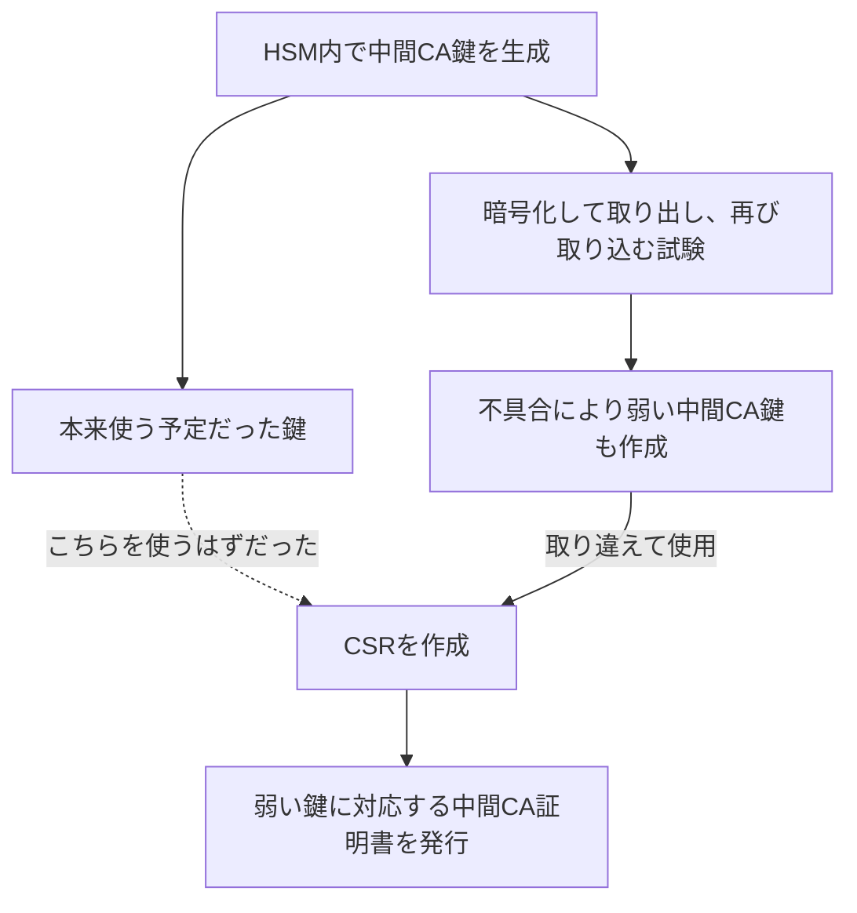
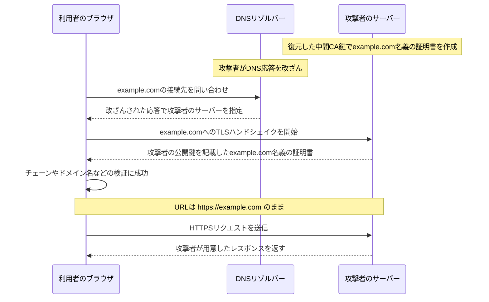
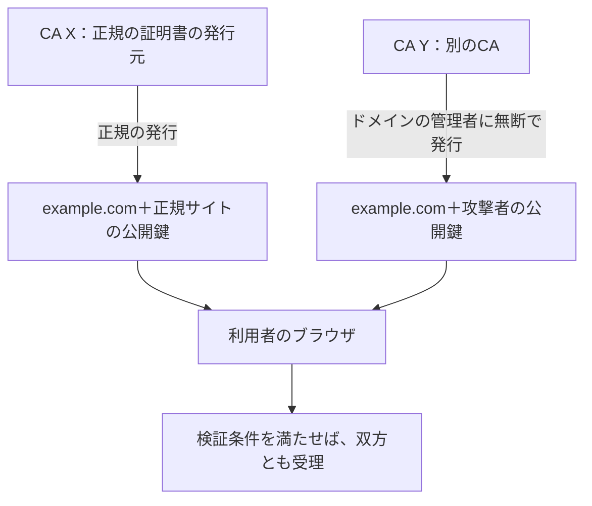
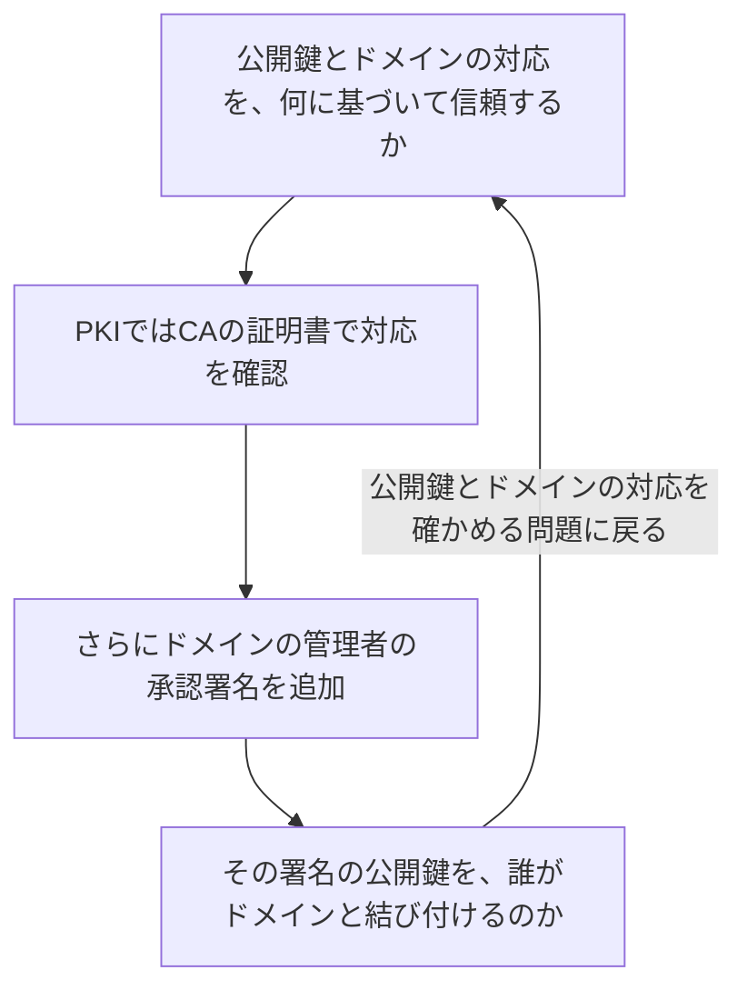
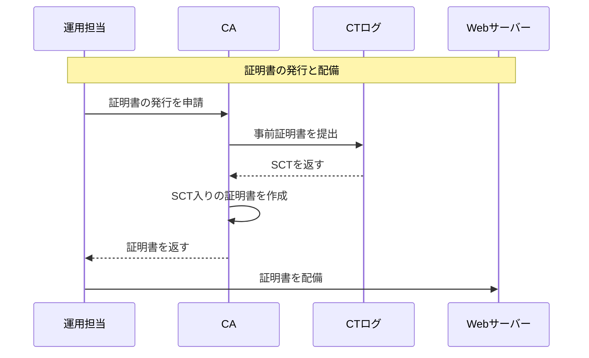
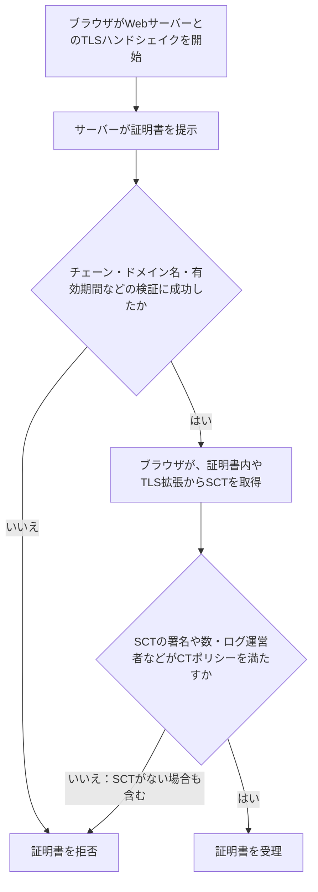
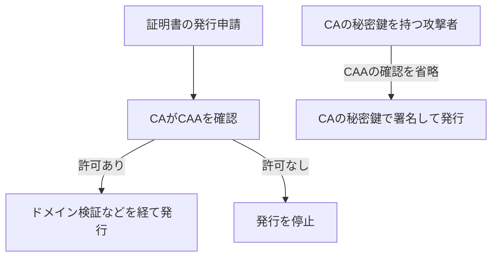
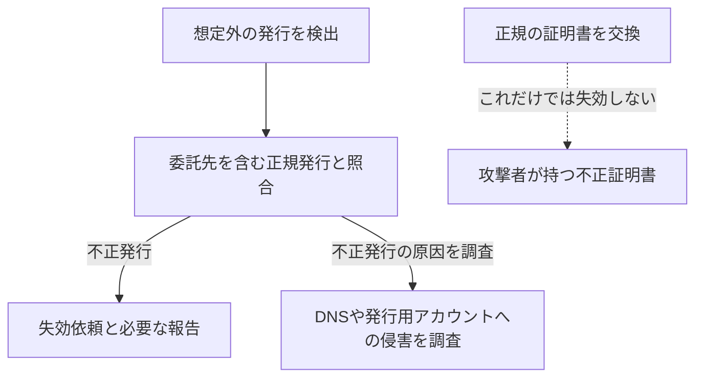
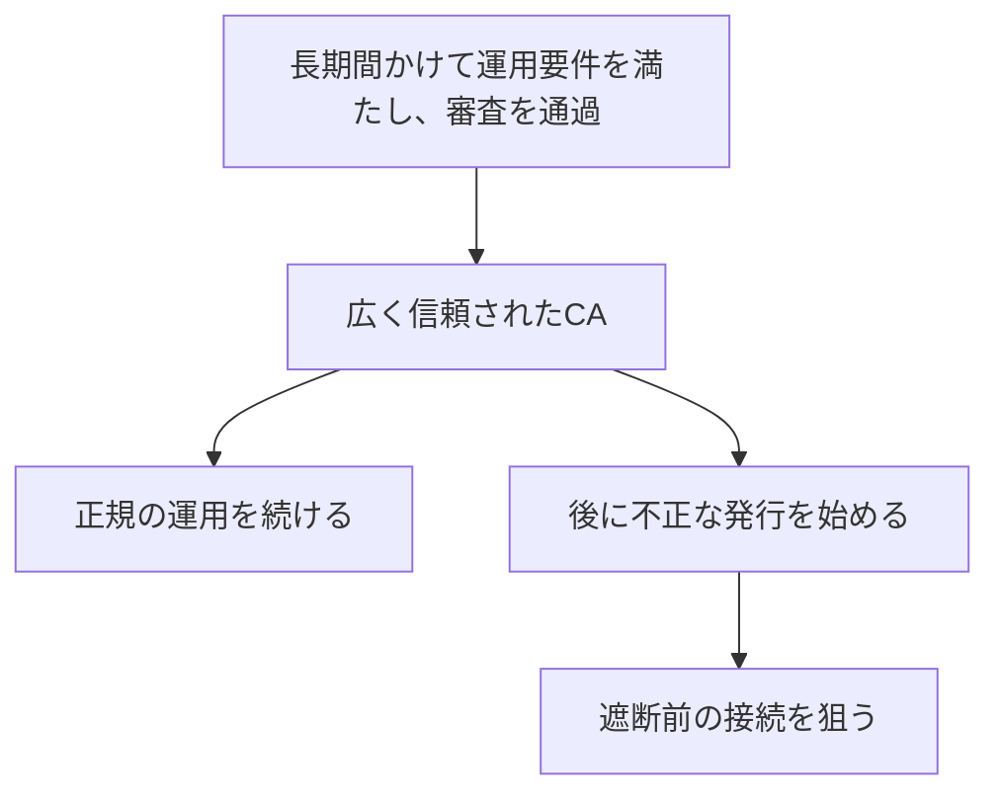

# eMudhraの事案から考える、TLSとWeb PKIの限界

今回は、eMudhraの中間CAの秘密鍵が公開情報から復元できた件を取り上げる。「秘密鍵が4だった」という話を見かけた方もいると思う。私には、同時期のPHPの話題に隠れていた印象があるが、他人のサイトになりすます証明書を誰でも作れる状態になっていたという点で、こちらのほうが深刻な問題だと感じた。[Cloudflareの分析][S3]

まずeMudhraで何が起きたかを振り返り、そこからWeb PKIがCAへの信頼にどこまで依存しているのかを確認する。そのうえで、CTやSCT、CAAによる対策を説明し、ユーザーとして何を知っておくべきか、アーキテクトとして何をすべきかを考える。

## 1. eMudhraで何が起きたのか

### 中間CAの秘密鍵を復元できると報告された

2026年10月、eMudhraの中間CAの秘密鍵が復元できると報告され、第三者もそのCAの有効な署名を持つ証明書を、任意のドメイン名に対して作成できることが明らかになった。[Mozilla][S1] [Google][S2]

### 小さな整数を秘密鍵に使っていた

問題の中間CAは、秘密鍵に「4」などのごく小さな整数を使っていた。そのため、公開されている中間CA証明書の公開鍵から、対応する秘密鍵を容易に特定できた。[Mozillaの調査、コメント5][S4c5]

通常、公開鍵から秘密鍵を求めることは計算上困難である。しかし、小さな整数から順に秘密鍵の候補を試せばよい場合は、各候補から公開鍵を計算し、証明書の公開鍵と一致するかを短時間で確かめられる。[Cloudflareの分析][S3]

### 本来使う予定だった鍵を、証明書の申請時に取り違えた

では、なぜそのような鍵が使われたのか。eMudhraの初期説明によると、米国と欧州のデータセンターで使うため、中間CAの鍵をHSMの外へ暗号化して取り出し、再び取り込むwrap/unwrapの試験を行っていた。HSMは、秘密鍵を生成・保管し、署名などの処理を行う装置である。[コメント11][S4c11][^cause]

試験用コードの不具合によって、本来使う予定だった中間CA鍵とは別に、秘密値の小さい中間CA鍵がHSM内に作られたという。両者のラベルが似ていたため、担当者は弱いほうの鍵で証明書の発行申請を作成した。この申請をCSRと呼ぶ。結果として、弱い鍵の公開鍵を含む中間CA証明書が発行された。

下図は、CSRの作成時に中間CAの署名用の鍵を取り違えた経緯を示している。



鍵と証明書の不一致を調べる機会は、秘密鍵の弱さが発覚する前にもあった。同社によると、本来使う予定だった鍵で証明書失効リストであるCRLに署名したところ、中間CA証明書の公開鍵では検証に失敗し、弱いほうの鍵で署名し直していた。証明書には弱い鍵の公開鍵が入っていたため、本来使う予定だった鍵による署名では検証に成功しなかったのである。[コメント11][S4c11]

### 最終報告は、提出予定日を過ぎても公開されていない

eMudhraは、KPMGへ独立レビューを依頼し、最終報告を2026年11月9日に共有すると説明していた。しかし、11月10日時点でも、Bugzillaと同社の公式告知では公開を確認できない。Bugzillaでは、予定日の11月9日に提出の有無と遅延理由を問われ、翌10日にも状況と新たな公開予定日を尋ねられている。原因については、まだ同社の初期説明に基づいている。[コメント73][S4c73] [コメント78][S4c78] [コメント80][S4c80] [公式告知][S5]

### 攻撃者のサーバーが正規サイトとして受け入れられる条件

復元された中間CA鍵を使うと、攻撃者は自分の署名鍵ペアに対して、他人のドメイン名の証明書を作成できる。証明書には攻撃者の公開鍵と、そのドメイン名を記載し、復元した中間CAの秘密鍵で署名する。証明書の署名は中間CAの公開鍵で正しく検証される。

例えば、利用者が `https://example.com` へアクセスしようとしたとする。攻撃者がDNS応答や通信経路を操作して、その通信を自分のサーバーへ誘導し、`example.com` 名義の不正証明書を提示する。提示された証明書が、信頼するルートCAからのチェーン、ドメイン名、有効期間、用途、CTなどについて、ブラウザの検証をすべて通過すると、攻撃者のサーバーとのTLS接続が成立する。URLは `https://example.com` のままでも、攻撃者は利用者が送受信する内容を読み取ったり、書き換えたりできる。[Google][S2] [Mozilla][S1][^impact]

次の図は、DNS応答を操作して利用者を攻撃者のサーバーへ誘導する場合を示している。



正規サイトの秘密鍵が侵害されていなくても、このなりすましは成立する。したがって、正規サイトがeMudhraの証明書を含むチェーンを使っていなくても、利用者側の証明書検証が不正証明書を受け入れるなら、攻撃者のサーバーが正規サイトとして受け入れられる。

### ブラウザ、OS、ランタイムで証明書を拒否する対策が配布された

なりすましへの対策には、問題の中間CA鍵で署名された証明書を、ブラウザやアプリケーションに拒否させる必要がある。

今回の中間CAには、eMudhraに加え、別の認証局であるSectigoも証明書を発行していた。同じ中間CAの公開鍵に対して二つの証明書があり、それぞれ異なるルートCAへつながるチェーンがあった。[Apple][S20] 両社は対象の中間CA証明書を失効させたが、すべてのクライアントが失効情報を取得して拒否するわけではない。そのため、各製品でも遮断情報の配信やソフトウェアの更新が行われた。[Mozilla][S1] [Go][S6]

端末は、登録済みのルート証明書を信頼の起点として、問題の中間CAを経由する証明書チェーンを検証していた。対策には、その中間CAを明示的に拒否する方法と、チェーンの検証に使うルート証明書を削除する方法がある。

次の表は、代表的な製品で配布された対策と、利用側で確認すべき更新対象をまとめたものである。Linuxについては、ディストリビューションの例としてUbuntuを挙げる。

| 製品・環境 | 配布された対策 | 利用側で確認すること |
| --- | --- | --- |
| Chrome・Android | ChromeはCRLSetで問題の中間CAの公開鍵を遮断。AndroidにもGoogle Play開発者サービス経由で対策を配信 | ブラウザや端末に対策が届いているか。[Google][S2] |
| Firefox | OneCRLで対象の中間CAを遮断し、FirefoxとNSSも更新 | 自動配信と製品更新の適用状況。[Mozilla][S1] |
| iPhone・Macなど | Appleの証明書設定データで中間CAを自動遮断し、関連ルートも遮断 | Safariなどには自動適用。Macの一部のコマンドラインツールや独自のCA一覧を持つアプリは別途確認する。[Apple][S20] |
| Windows・Edge・WebView2 | Windowsの拒否リストと、Edge・WebView2のCRLSetを更新。関連ルートなどを削除する更新も配布 | Windowsの証明書リスト・OS更新と、ブラウザのコンポーネント更新の双方。[Microsoft][S21] |
| Node.js | 22・24・26系に、遮断対象の公開鍵を含むチェーンを拒否する修正などを配布 | 修正版へのランタイム更新とプロセスの再起動、コンテナなどへの再配備。[Node.js][S22] [24系の変更内容][S25] |
| Ubuntu | `ca-certificates` を更新し、関連するルート証明書を削除 | OSとコンテナ内のCAパッケージ。削除対象はUbuntuのリリースによって異なる。[USN-8944-1][S23] [USN-8944-2][S24] |
| Go製アプリケーション | 標準ライブラリの証明書検証処理に、問題の中間CAを拒否する修正を追加 | 修正済みGoでアプリケーションを再ビルドし、配備する。[Go][S6] |

利用者のブラウザに対策が配信されても、自社アプリケーションの対応が済んだことにはならない。外部APIへの接続などに使う実装と実行環境ごとに、更新の適用を確認する必要がある。

## 2. なぜ一つのCAの問題に、世界中が対応しなければならないのか

eMudhraが不適切な鍵を使ったことは、まず同社の運用上の失敗である。しかし、なぜ一つのCAの失敗に対して、無関係な企業のサイトやアプリケーションまで対応しなければならないのか。それは、自社が選んだCA以外も、自社ドメイン名の証明書を発行できるためである。

### CAは、ドメインの管理者からの承認なしに有効な証明書を作成できる

CAは、ドメインの管理者の承認がなくても、任意のドメイン名を記載した証明書を作成し、署名できる。[^constraints]

もちろん、CAの運用ルールは、証明書の申請者がそのドメインを管理していることの確認を義務付けている。DNSへ指定の値を設定させたり、Webサーバーから指定の応答を返させたりするのは、この確認のためである。無断で発行しないという制約は、CAがこうしたルールを守ることで成り立っている。[Baseline Requirements][S9]

ブラウザは、発行元CAの公開鍵による署名検証に加え、ドメイン名、有効期間、用途、後述するCTについてブラウザが定める条件などを確認する。しかし、これらの検証で、ドメインの管理者が発行を許可したかどうかを確認しているわけではない。[RFC 5280の6節][S8]

例えば、自社がCA Xから証明書を取得していても、別のCA Yが、同じドメイン名と攻撃者の公開鍵を記載した証明書を無断で発行できる。その証明書から利用者のブラウザに登録されたルートCAまでのチェーンを検証でき、ほかの検証条件も満たしていれば、ブラウザは受理する。

下図は、CA Xが発行した正規の証明書と、CA Yが無断で発行した証明書を、ブラウザがともに受理する場合を示している。自社が発行元をCA Xに決めても、ブラウザがCA Yの証明書を拒否することにはならない。



また、第三者がCAの秘密鍵を盗んだり、今回のように復元したりすれば、CAの発行システムを使わずに証明書を作成できる。CA自身が運用ルールを守っていても、秘密鍵を得た攻撃者による発行は防げない。

### ドメインの管理者が証明書に署名すれば解決するか

CAが発行した証明書について、ドメインの管理者が発行を許可したことも確認できるようにしたいとする。例えば、ドメインの管理者が持つ別の秘密鍵で、その証明書に追加の署名を行うのはどうだろうか。

この署名を検証するには、ドメインの管理者の公開鍵が必要である。しかし、取得した公開鍵が本当にそのドメインの管理者のものかは、別に確かめなければならない。攻撃者も自分の鍵を作り、その鍵で追加の署名を行えるため、署名が検証できることだけでは、そのドメインの管理者からの許可を確認したことにならない。

下図は、証明書に承認の署名を追加しても、公開鍵とドメインの対応をどう確かめるかという、PKIが扱う問題に戻ることを示している。



署名の検証を重ねるだけでは、公開鍵とドメインの対応を信頼する出発点は得られない。Web PKIでは、その出発点として、OSやブラウザなどが選んだルートCAをあらかじめ信頼している。このような検証の出発点を、信頼アンカーと呼ぶ。ルートCAを信頼する判断自体は、その証明書の署名から導かれるものではなく、採用審査や運用要件などに基づいて行われる。[RFC 5280の6節][S8] [Baseline Requirements][S9]

事前の鍵共有やDNSSECを使う方法もあるが、その場合も、共有した鍵やDNSSECの信頼アンカーをあらかじめ信頼する必要がある。[^dane]

## 3. CTで証明書の発行を公開し、監視する

CAが不正な証明書を発行しても、その発行内容を外から調べられれば、ドメインの管理者が発見できる。Certificate Transparency、CTは、この目的のために証明書の発行内容を公開ログへ記録する仕組みである。ただし、CTログは、ドメインの管理者が発行を許可したかを審査するものではない。[RFC 6962の1節][S10]

### ドメインの管理者が公開された発行内容を監視する

ドメインの管理者や監視サービスは、CTログから記録を取得し、自分のドメイン名が含まれる証明書を探せる。申請した覚えのない証明書があれば、社内や委託先による正規の発行かを照合する。

不正発行と分かった場合は、CAへ失効を求め、必要に応じてブラウザのルートプログラムなどへ報告する。記録が公開されるだけで、不正発行の判定や失効まで自動的に行われるわけではない。発行内容を監視し、調べ、対応する人やサービスが必要である。[RFC 6962の5.3節と7.2節][S10]

### 証明書や事前証明書をログへ提出してSCTを取得する

CTログへの提出には、完成した証明書を送る方法と、発行前に事前証明書を送る方法がある。事前証明書は、発行予定の証明書に入れるドメイン名や公開鍵などを記載し、CAがログへの提出用に作成する証明書である。利用者とのTLS接続に使う最終的な証明書とは異なる。[RFC 6962の3.1節][S10]

どちらを提出した場合も、ログはSCTを返す。SCTはSigned Certificate Timestampの略で、提出された証明書、または事前証明書の情報を、規定の時間内に公開ログへ追加するという、ログ運営者の署名付きの約束である。[RFC 6962の3.2節][S10]

次の表は、ログへ提出するものと、取得したSCTをブラウザへ提示する方法の例を示している。[RFC 6962の3.3節][S10]

| ログへ提出するもの | SCTを取得する時期 | ブラウザへの提示方法の例 |
| --- | --- | --- |
| 事前証明書 | 最終的な証明書の発行前 | CAが最終的な証明書へSCTを埋め込み、Webサーバーがその証明書を送る |
| 完成した証明書 | 証明書の発行後、利用者へ提示する前 | Webサービスの運用担当などが取得したSCTをサーバーへ設定し、TLSハンドシェイク中にTLS拡張で証明書とは別に送る |

以下の図では、CAが事前証明書を提出し、SCTを最終的な証明書へ埋め込む方式を示す。



図では一つのCTログに簡略化しているが、ブラウザのCTポリシーによっては、複数のログや異なる運営者からのSCTが必要になる。[ChromeのCTポリシー][S11]

### ブラウザはTLSハンドシェイク中にSCTを確認する

ブラウザは、TLSハンドシェイク中に次のようにしてSCTを確認する。下図は、Chromeなどが公開Webサイトの証明書にCTを必須とする場合の、証明書を受理・拒否する分岐を示している。[RFC 6962の5.2節][S10] [ChromeのCTポリシー][S11]



ブラウザは、証明書に埋め込まれたSCTだけでなく、TLS拡張で提示されたSCTも検証する。完成した証明書をログへ提出する方式でも、取得したSCTを提示し、ブラウザのCTポリシーを満たせば受理される。証明書自体にSCTが埋め込まれていないことだけで、拒否されるわけではない。[^sct-delivery]

Chromeには、SCTの署名を検証するためのCTログの公開鍵があらかじめ組み込まれている。この公開鍵を使って署名を検証するため、その場でCAやCTログへ問い合わせる必要はない。[RFC 6962の5.2節][S10] [ChromeのCTログ一覧][S26]

### ログ運営者が記録を追加し、過去の記録を変更していないことを確認する

SCTは、証明書や事前証明書の情報を、規定の時間内に公開ログへ記録するという約束である。SCTの署名を検証しても、ログへ実際に記録されたことまでは確認できない。そのため、ログを監査するサービスや監視者が、期限までに記録が追加されたかを確認する。また、過去の記録が削除されたり、書き換えられたりしていないかも確認する必要がある。

CTログは、Merkle treeというデータ構造を使って記録を管理している。監査者は、ログが公開する署名付きのハッシュ値と、ログから取得した証明用データを使い、次の二点を検証できる。[RFC 6962の2節と5.4節][S10]

| 監査者が確かめること | 取得するデータと行う検証 |
| --- | --- |
| SCTに対応する証明書や事前証明書の情報が公開ログに含まれるか | 記録を追加すべき期限の経過後に包含証明を取得し、そのログに記録が含まれるかを検証する |
| 過去に確認した記録が残り、新しい記録だけが追加されたか | 以前と現在のログに対する整合性証明を検証する |

### eMudhraの事案でCTが果たした役割

Googleによると、Chromeで問題の中間CAを拒否する対策を行う前には、その中間CA配下のTLS証明書はCTログに記録されていなかった。必要なSCTを提示できないため、対策前でも、CTを必須とするクライアントには不正証明書を使えなかった。[Google][S2]

一方、攻撃者が作った証明書でも、CTログの受け付け条件を満たせば、記録されてSCTを得る可能性がある。[RFC 6962の7節][S10]

## 4. CAAで発行を許可するCAを指定する

発行を公開するCTに加え、ドメインの管理者の発行方針を、DNSでCAへ伝える方法もある。CAAレコードを使うと、どのCAからの発行を許可するかを指定できる。例えば次の設定では、ワイルドカード以外の証明書の発行をLet's Encryptだけに許可し、ワイルドカード証明書の発行は許可しない。[RFC 8659の3節と4節][S12]

```dns
example.com.  CAA 0 issue "letsencrypt.org"
example.com.  CAA 0 issuewild ";"
```

CAAに従うCAは、この指定を確認して発行を判断する。一方、CAの秘密鍵を得た攻撃者は、その確認を行わずに、同じ鍵で証明書を発行できる。下図は、CAAによる制限が、発行者自身の確認に依存することを示している。



CA自身が指定を無視する場合も、CAAレコードだけでは発行を止められない。通常のクライアントは、接続時の証明書検証にCAAを使わないからである。RFC 8659も、その用途にCAAを使わないよう定めている。[RFC 8659の1節と5節][S12]

### CTとCAAによっても、CAの発行権限は残る

次の表は、CAによる無断発行に対して、CAA、CT、失効や遮断で何ができ、どのような課題が残るかを示している。

| 対策 | 効果 | 残る課題 |
| --- | --- | --- |
| CAA | 指定に従うCAの発行を制限する | CA自身やCAの秘密鍵を得た攻撃者は、指定を無視できる |
| CT | 発行を監視可能にし、必要なSCTのない証明書を拒否させる | ドメインの管理者に無断で発行した証明書でも、SCTを含む検証条件を満たせば受理される |
| 失効・中間CAの遮断・ルートの削除 | 失効確認や遮断情報の適用、チェーンの検証によって、不正証明書を拒否する | 不正発行を発見する前や、拒否するための変更が届いていないクライアントでは、検証条件を満たす不正証明書が受理される |

CTとCAAを導入しても、CAがドメインの管理者に無断で証明書を発行する能力は残る。

## 5. 我々は何を知り、何をすべきか

### ユーザーとして必要な更新を適用する

個々のユーザーがすべてのCAの運用を審査することはできない。実際には、ブラウザやOSなどが選んだルートCAを信頼の起点とし、開発元が配信する中間CAの遮断やルートの削除も適用している。ブラウザ、OS、アプリケーションを更新し、必要な再起動を行うことが基本になる。[Google][S2] [Mozilla][S1]

証明書エラーが出た場合は、警告を無視して接続したり、由来を確認していないルート証明書を追加したりしない。ただし、不正証明書が検証を通る場合には、警告そのものが出ない。ユーザーの注意だけに頼ることはできず、問題の証明書を拒否する変更をクライアントへ反映する必要がある。

### 自社が選んでいないCAの事故も確認する

アーキテクトとしては、自社の証明書チェーンにeMudhraが含まれていないという理由だけで、影響なしと判断してはならない。利用者のブラウザや、外部APIへ接続する自社アプリケーションが、問題の中間CAを経由するチェーンを受理するかも確認する必要がある。

そのため、自社ドメインの不正証明書を発見すること、外部サービスのなりすまし先へのTLS接続を拒否すること、受理されなくなった正規の証明書を交換することに、それぞれ準備が必要である。次の表は、三つの問題に対応する準備を示している。

| 想定する問題 | 準備すること |
| --- | --- |
| 自社ドメインの不正発行 | CT監視、正規発行との照合、失効や遮断を依頼する手順 |
| 外部APIなどへのなりすまし | 信頼ストアとTLS実装の把握、緊急更新の手順 |
| 正規の証明書が信頼されなくなる | 全配備先の台帳、期限前の再発行、代替CAへの移行手順 |

### 外部接続で使う信頼情報と検証処理を把握する

外部接続のなりすましへ対応するには、アプリケーションが何を使って証明書を検証しているかを把握する必要がある。次の表のように、信頼情報や検証処理の所在によって更新対象は異なる。OSを更新すれば、同じサーバー上のアプリケーションすべてに反映されるとは限らない。

| アプリケーションが使うもの | 対応例 | 適用時の確認 |
| --- | --- | --- |
| OSの信頼ストア | OSやCAパッケージを更新する | 実行中のプロセスへ反映されたか |
| アプリケーションに同梱したCA一覧 | CA一覧を更新して再配備する | 同梱元の更新が、実行環境にも反映されたか |
| ランタイムの証明書検証処理 | 修正済み版へ更新する | 再ビルドや再配備が必要か |

Goでは、証明書検証の修正がアプリケーションのバイナリに組み込まれるため、修正済みツールチェーンで再ビルドし、配備する必要がある。[Go][S6] Cloudflareは、共有の信頼ストアやベースイメージの更新に加え、独自のストアを持つアプリケーションにも個別に対応したと報告している。[Cloudflare][S15]

外部API、バッチ、Webhook、オリジン向けプロキシなどについて、信頼ストアとTLS実装、更新担当者、反映方法を記録しておく。事故が起きたときに、どのアプリケーションを誰が更新し、再起動や再配備が必要かを特定できる状態にする。

ルート証明書を削除する方法で対応する場合は、別のルートへつながるチェーンでも受理されないかを確認する。今回のeMudhra側とSectigo側のように、問題の中間CAに複数のチェーンがある場合、一方だけを拒否しても対策は完了しない。[Apple][S20]

### CTの通知を調査と失効依頼につなげる

CTの通知と照合できるよう、CDNやSaaSが代理で取得した証明書も、正規の発行として台帳に記録しておく。下図は、発行内容の照合から調査へ進む手順を示している。もう一つの処理は、正規の証明書を交換しても、攻撃者が持つ不正証明書は失効しないことを示している。



不正発行ならCAへ失効を求め、必要に応じてルートプログラムへ遮断を依頼する。同時に、DNSやドメイン管理アカウント、発行用トークンの侵害も調べ、見つかった侵害に対処する。[CTの監視者の役割][S10]

### 正規の証明書を、有効期限前でも交換できるようにする

中間CAの遮断やルートの削除では、そのCAを経由する正規の証明書も受理されなくなる場合がある。今回もGoogleは、G3ルートにつながる証明書について、別のルートCAまで検証できるチェーンへの交換を案内した。有効期限だけを見て更新を管理していると、このような緊急交換に対応できない。[移行案内][S2]

交換には、再発行だけでなく、対象の特定、全配備先への反映、利用者の接続確認までが必要である。そのために平常時から準備する内容を、次の表に示す。

| 平常時に用意するもの | 緊急時に行うこと |
| --- | --- |
| 証明書と全配備先の台帳 | 対象を特定する |
| 発行と配備の自動化 | 通常の更新時期を待たず、一括交換する |
| 代替CAでの発行手順 | 必要な審査、ドメイン検証、CAA変更を行う |
| 主要クライアントでの確認手順 | 新しいチェーンで接続できるか確かめる |

### 管理できる接続では、信頼するCAを限定する

接続元と接続先の双方を管理できるなら、専用のCAだけを信頼するなど、無関係な公開CAの誤発行を受理しない構成にできる。ただし、登録したCAや固定した鍵を変更するときの更新手順も必要である。

一方、不特定多数のブラウザへ公開するサービスでは、利用者の信頼ストアをサービス側で一律に変更できない。信頼先を限定できる接続では範囲を絞り、一般のブラウザへの公開では、CTやCAA、事故への対応を整えることになる。

## 6. CAの権限が大きいこと自体のリスク

最後に、私が個人的に一番問題だと考えているのは、一つのCAが証明書を発行できるドメインの範囲が広すぎる点である。eMudhraでは運用上の失敗が問題になったが、同じ権限を意図的に悪用したい組織や国家についても考える必要がある。

例えば、長い時間と資金をかけてCAの運用要件を満たし、広く信頼されるようになってから、不正な発行を始める攻撃が考えられる。採用時に適切に運用されていても、その後に運営者が権限を悪用する可能性は残る。下図は、CAの採用審査を通過した後に、不正発行を始める場合を示している。



採用後も監査などの要件は続く。しかし、それらの要件を守らせることと、不正な証明書を技術的に作れなくすることは異なる。既存のCAを侵害したり、運営へ圧力をかけたりして、その権限を利用する方法も考えられる。[公開CAの運用要件][S9]

CTで発見して信頼を取り消しても、それ以前の通信を後から保護することはできない。特定の相手を狙う攻撃なら、不正証明書が短時間だけ受理されることにも意味がある。

CAの権限が広いからこそ、攻撃者には、その権限を得るために長期間の準備へ費用をかける動機がある。個々のCAが適切に運用されているかだけでなく、一つの組織に、どれほど広い範囲のドメイン名と公開鍵の対応を証明する権限を委ねているかという問題も、残っている。

[^cause]: <!-- 要更新：最終報告の公開後、弱い秘密値が生じた具体的な処理とHSMの操作を確認する。 --> 2026年11月10日時点では、原因について最終報告による確認はできていない。[コメント73][S4c73] [コメント80][S4c80]

[^sct-delivery]: RFC 6962は、証明書への埋め込み、TLS拡張、OCSP Staplingによる提示を定義している。ただし、提示方法の対応状況はブラウザにより異なる。Chrome 148以降はOCSP応答内のSCTをCTポリシーへの適合に使わないため、本文と図では証明書への埋め込みとTLS拡張を扱う。[RFC 6962の3.3節][S10] [ChromeのCTポリシー][S11]

[^constraints]: 中間CAのnameConstraintsなどにより、チェーンの検証時に受け入れる名前の範囲は制限できる。本文では、その制限の範囲に対象ドメイン名が含まれるCAを扱う。[RFC 5280の4.2.1.10節][S8]

[^dane]: DANEでは、DNSSECで検証可能なTLSAレコードにより、ドメインの管理者が証明書や鍵との結び付きを公開する。クライアントの対応と、DNSSECへの信頼が必要になる。[RFC 6698][S17]

[^impact]: Cloudflareは偽造証明書を観測したが、自社接続の傍受を確認したとはしていない。[観測報告][S3] また、中間CAの秘密鍵だけから、TLS 1.3のECDHEで確立済みの通信のセッション鍵は得られない。[RFC 8446][S7]

## 参照資料

参照日：2026年11月7日。Apple・Microsoft・Node.js・Ubuntu・Goの対応は11月8日に再確認。最終報告の公開状況、CTの仕様、ChromeのCTポリシーは11月10日に再確認。

1. [Mozilla: Protecting Firefox users following the compromise of eMudhra intermediate certificates][S1]。2026年10月20日公表。OneCRL、Firefox、NSSによる対応。
2. [Google: Protecting Chrome and Android Users from Compromised eMudhra Intermediate CA Certificates][S2]。2026年10月20日公表、11月4日追記。CRLSet、CTによる保護、ルートの信頼変更。
3. [Cloudflare: 4 real? Tracking exploitation and patching of eMudhra’s weak keys][S3]。2026年10月30日公表。8鍵の値と偽造証明書の観測。
4. [Mozilla Bug 2083449][S4]。Descriptionとコメント1、5、11、73、78、80。対象鍵、生成経緯の初期説明、最終報告の予定と遅延。
5. [eMudhra: Statement on Recent Certificate Security Incident][S5]。当事者の公式更新。独立レビューと利用者の移行。
6. [Go: Our Response To The eMudhra Key Disclosure Incident][S6]。2026年10月26日公表。証明書検証の修正と再ビルド。
7. [RFC 8446: The Transport Layer Security Protocol Version 1.3][S7]。2節、4.4節、付録E。
8. [RFC 5280: Internet X.509 Public Key Infrastructure Certificate and CRL Profile][S8]。4.2.1.10節、6節。
9. [CA/Browser Forum: Baseline Requirements][S9]。確認時の版は2.3.1、2026年10月4日。3.2.2.4節、6.1.1節など。
10. [RFC 6962: Certificate Transparency][S10]。CTの基本設計、SCT、ログの検証、監視者の役割。後続仕様には[RFC 9162][S19]がある。
11. [Chrome Certificate Transparency Policy][S11]。Chromeが要求するSCTの条件。
12. [RFC 8659: DNS Certification Authority Authorization Resource Record][S12]。1節、3節、4節、5節。
13. [RFC 8657: CAA Record Extensions for Account URI and ACME Method Binding][S13]。
14. [Cloudflare: 8 eMudhra certificates are compromised. Here's what you need to know][S15]。2026年10月20日公表。外向き接続と信頼ストアへの対応。
15. [RFC 9773: ACME Renewal Information Extension][S16]。
16. [RFC 6698: The DNS-Based Authentication of Named Entities TLS Protocol: TLSA][S17]。
17. [RFC 2986: PKCS #10: Certification Request Syntax Specification Version 1.7][S18]。4節。
18. [Apple: About the compromised eMudhra intermediate CAs][S20]。Appleの自動遮断と、Macのコマンドラインツールに残る別の検証経路。
19. [Microsoft’s response to compromised eMudhra certificate authority keys][S21]。2026年10月26日公表、27日更新。Windows、Edge、WebView2の遮断と信頼リストの変更。
20. [Node.js: Wednesday, October 21, 2026 Security Releases][S22]。22・24・26系の修正版を案内。
21. [Ubuntu: USN-8944-1][S23]、[USN-8944-2][S24]。2026年10月20日公表。リリースごとのCAパッケージ更新。
22. [Node.js 24.22.1の変更内容][S25]。2026年10月21日公表。公開鍵の遮断とルート証明書の更新。
23. [Chrome’s CT Log Lists][S26]。Chromeに組み込まれるCTログ一覧と、そのデータ形式。

[S1]: https://blog.mozilla.org/security/2026/10/20/protecting-firefox-users-following-the-compromise-of-emudhra-intermediate-certificates/
[S2]: https://blog.google/security/protecting-chrome-and-android-users-from-compromised-emudhra-intermediate-ca-certificates/
[S3]: https://blog.cloudflare.com/emudhra-patching
[S4]: https://bugzilla.mozilla.org/show_bug.cgi?id=2083449
[S4c11]: https://bugzilla.mozilla.org/show_bug.cgi?id=2083449#c11
[S4c73]: https://bugzilla.mozilla.org/show_bug.cgi?id=2083449#c73
[S4c78]: https://bugzilla.mozilla.org/show_bug.cgi?id=2083449#c78
[S4c80]: https://bugzilla.mozilla.org/show_bug.cgi?id=2083449#c80
[S26]: https://googlechrome.github.io/CertificateTransparency/log_lists.html
[S5]: https://emudhra.com/en/post/certificate-security-incident
[S6]: https://go.dev/blog/emudhra-incident
[S7]: https://www.rfc-editor.org/rfc/rfc8446.html
[S8]: https://www.rfc-editor.org/rfc/rfc5280.html
[S9]: https://cabforum.org/working-groups/server/baseline-requirements/requirements/
[S10]: https://www.rfc-editor.org/rfc/rfc6962.html
[S11]: https://googlechrome.github.io/CertificateTransparency/ct_policy.html
[S12]: https://www.rfc-editor.org/rfc/rfc8659.html
[S13]: https://www.rfc-editor.org/rfc/rfc8657.html
[S14]: https://www.chromium.org/Home/chromium-security/education/tls/
[S15]: https://blog.cloudflare.com/emudhra-certificate-compromise/
[S16]: https://www.rfc-editor.org/rfc/rfc9773.html
[S17]: https://www.rfc-editor.org/rfc/rfc6698.html
[S18]: https://www.rfc-editor.org/rfc/rfc2986.html
[S19]: https://www.rfc-editor.org/rfc/rfc9162.html

[S4c5]: https://bugzilla.mozilla.org/show_bug.cgi?id=2083449#c5

[S20]: https://support.apple.com/en-us/149555
[S21]: https://www.microsoft.com/en-us/msrc/blog/2026/10/microsoft-response-to-compromised-emudhra-certificate-authority-keys
[S22]: https://nodejs.org/en/blog/vulnerability/october-2026-security-releases
[S23]: https://ubuntu.com/security/notices/USN-8944-1
[S24]: https://ubuntu.com/security/notices/USN-8944-2
[S25]: https://nodejs.org/en/blog/release/v24.22.1/
