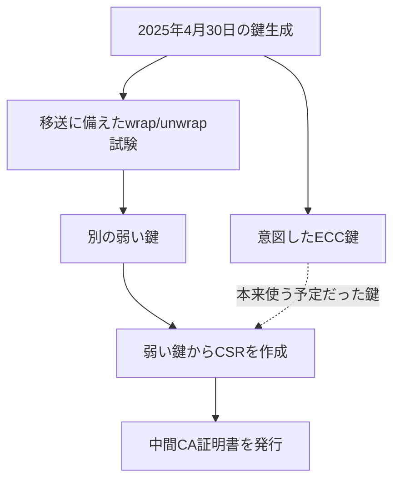
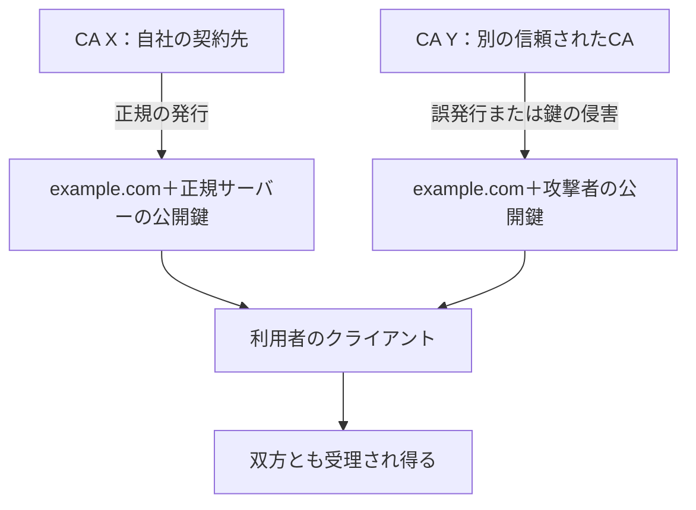
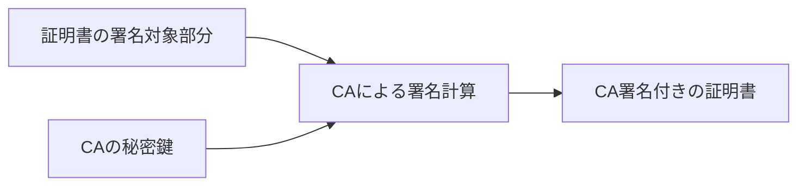
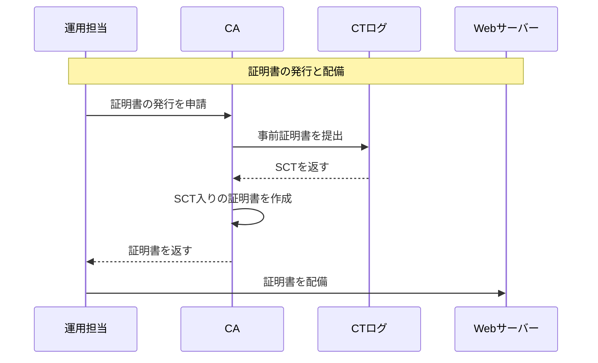
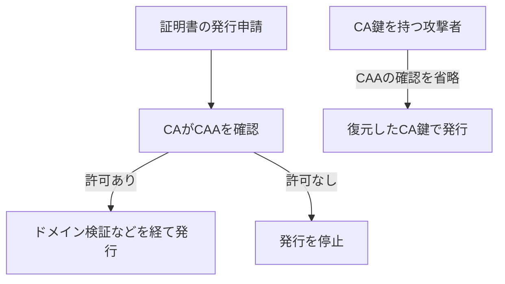
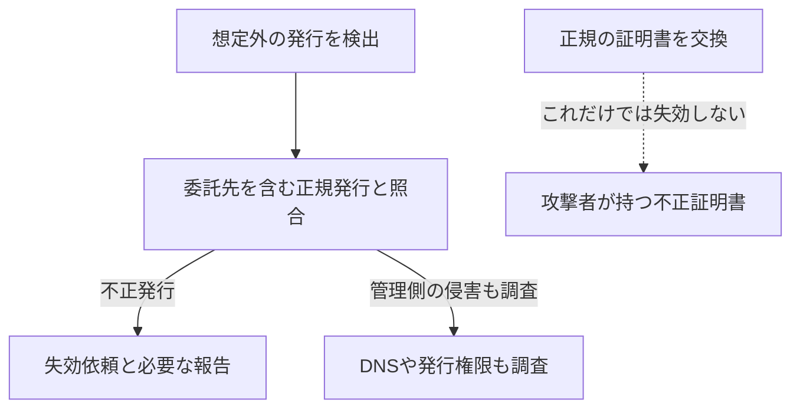
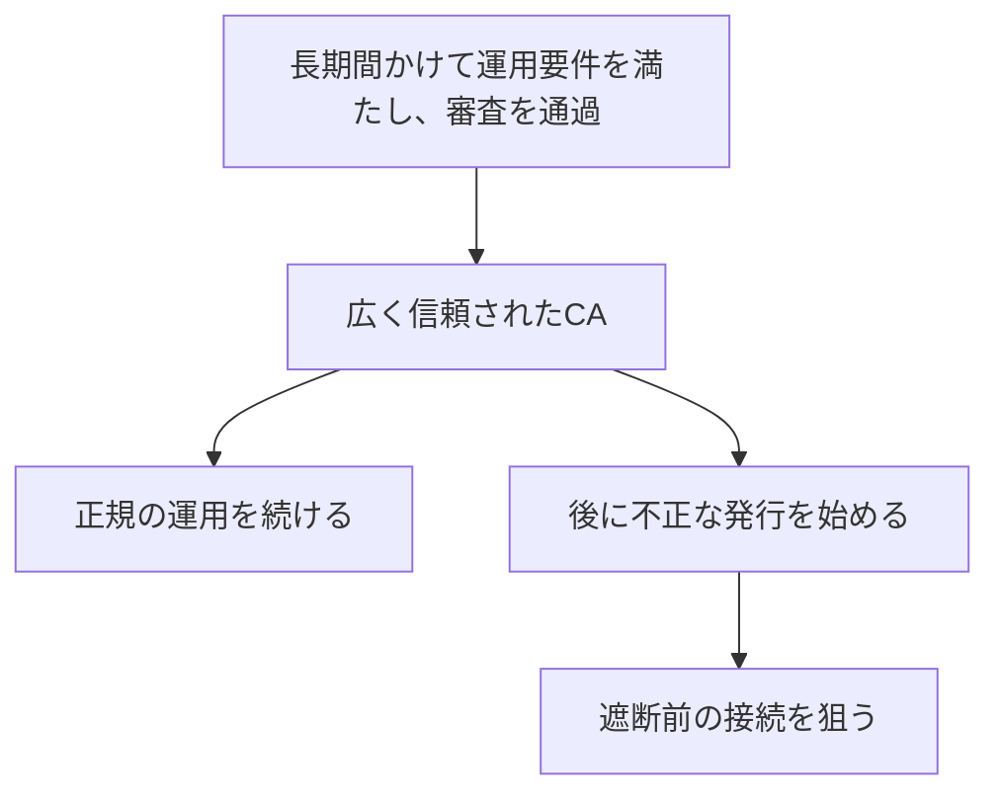

# eMudhraの事案から考える、TLSとWeb PKIの限界

今回は、eMudhraの中間CAの秘密鍵が公開情報から復元できた件を取り上げる。「秘密鍵が4だった」という話を見かけた方もいると思う。私には、同時期のPHPの話題に隠れていた印象があるが、他人のサイトになりすます証明書を誰でも作れる状態になっていたという点で、こちらのほうが深刻な問題だと感じた。[Cloudflareの分析][S3]

まずeMudhraで何が起きたかを振り返り、そこからWeb PKIがCAへの信頼にどこまで依存しているのかを確認する。そのうえで、CTやSCT、CAAによる対策を説明し、ユーザーとして何を知っておくべきか、アーキテクトとして何をすべきかを考える。

## 1. eMudhraで何が起きたのか

### 中間CAの秘密鍵を復元できると報告された

2026年10月、研究者がeMudhraの中間CAの秘密鍵を復元できると報告した。第三者がこの鍵を得ると、その中間CAと同じ秘密値を使って、証明書の署名を作成できる。証明書の署名検証に関しては、中間CA自身が発行した証明書と区別できないものを作れる状態だった。[Mozilla][S1] [Google][S2]

### 小さな整数を秘密鍵に使っていた

この復元が可能だったのは、秘密鍵にごく小さな整数が使われていたためである。例えば、問題の鍵の一つは「4」だった。秘密鍵の候補から公開鍵を計算し、中間CA証明書に記載された公開鍵と照合することで、同じ秘密値を特定できた。[Mozillaの調査、コメント5][S4c5] [Cloudflareの分析][S3]

公開鍵から秘密鍵を求めることは通常は計算上困難だが、候補が少なければ、一つずつ試して一致を確かめられる。今回は、公開された中間CA証明書から、運用に使われる秘密鍵そのものを復元できてしまった。

### 意図した鍵とは別の鍵で証明書を申請した

では、なぜそのような鍵が中間CA証明書に使われたのか。eMudhraの初期説明によると、鍵の移送に備えて、鍵を保護した形式へ変換し、そこから復元するwrap/unwrapの試験を行っていた。この処理に関係するコードの不具合で別の弱い鍵ができ、ラベルが似ていたため、その鍵を使って証明書の発行申請となるCSRを作成したという。[コメント11][S4c11][^cause]

同社の説明では、この取り違えによって、本来使う予定だった鍵とは別の鍵に中間CA証明書を発行したことになる。下図は、意図した鍵と、実際に証明書の発行へ使われた鍵の対応を示している。



さらに同社は、以前に元の鍵で証明書失効リストであるCRLへ署名した際、証明書の公開鍵で検証できず、弱い鍵で署名し直したとも説明している。意図した鍵と証明書が食い違っていることを調べる機会は、秘密鍵の弱さが発覚する前にもあった。[コメント11][S4c11]

### 第三者が、他人のドメイン名の証明書を発行できる

こうして復元された鍵は、個々のWebサイトのサーバー鍵ではなく、中間CAが証明書の発行に使う鍵である。攻撃者は、自分で用意したサーバーの公開鍵と、他人のドメイン名を含む証明書を作り、復元した中間CA鍵で署名できる。中間CAの公開鍵による署名検証は、この証明書に対しても成功する。

その中間CAを引き続き信頼し、名前、有効期間、用途、CTなどの検証条件も満たすクライアントでは、不正証明書が受理され得る。攻撃者が被害者の接続を自分のサーバーへ到達させられれば、正規サイトになりすまして通信を読み取ったり、書き換えたりできる。[Google][S2] [Mozilla][S1][^impact]

このとき証明書が認証するのは、正規サイトの公開鍵ではなく、攻撃者が用意した公開鍵である。正規サイトの証明書や鍵が侵害されていなくても、別の証明書によるなりすましが成立し得るため、eMudhraと取引していないサイトにも影響が及ぶ。

### クライアント側で問題のCAを拒否する変更が配布された

この危険を止めるには、問題の中間CAにつながる証明書を、クライアントに拒否させる必要がある。eMudhraによる対象中間CA証明書の失効に加え、ブラウザやランタイムの開発元も、次の対策を実施した。

| 対応主体 | 実施した対策 |
| --- | --- |
| Google | ChromeのCRLSetで、問題の中間CAの公開鍵を遮断 |
| Mozilla | OneCRLによる遮断を配信し、FirefoxとNSSも更新 |
| Go開発チーム | 証明書の検証処理を修正した緊急リリースを配布 |

ブラウザに配信する遮断情報が、サーバー側のアプリケーションにも適用されるとは限らない。Go開発チームは、特にLinuxで共通の失効確認機構がないことなどから、検証処理の修正が必要だったと説明している。同じCAを信頼しているソフトウェアでも、危険な証明書を拒否する変更の適用方法は異なっていた。[Google][S2] [Mozilla][S1] [Go][S6]

## 2. なぜ一つのCAの問題に、世界中が対応しなければならないのか

eMudhraが不適切な鍵を使ったことは、まず同社の運用上の失敗である。しかし、なぜ一つのCAの失敗に対して、無関係な企業のサイトやアプリケーションまで対応しなければならないのか。自社の証明書は別のCAから取得していて、鍵も適切に管理している。それでも影響を受ける理由は、CAが認証できるドメインの範囲にある。

### 自社が契約していないCAも、自社ドメインを認証できる

自社がCA Xから証明書を取得していても、利用者のクライアントは、通常はCA X以外も信頼している。別のCA Yが同じドメイン名の不正証明書を発行した場合でも、CA Yにつながる信頼パスなどの検証を通れば、クライアントはその証明書を受理し得る。下図では、同じドメイン名に対し、異なるCAが異なる公開鍵を認証している。



クライアントは、名前、署名、有効期間、用途、追加ポリシーなどを検証する。「このドメインはCA Xと契約しているから、CA Yの証明書を拒否する」とは判断しない。証明書を取得する企業が契約先を選んでも、そのドメインを認証できるCAを一社に限定したことにはならない。[RFC 5280の6節][S8]

### CAは、ドメインの管理者からの承認なしに有効な証明書を作成できる

もちろん、CAには申請者のドメイン管理権限を確認する義務がある。DNSへ指定の値を設定させたり、Webサーバーから指定の応答を返させたりする確認である。しかし、対象ドメインを認証する権限を持つCAは、この手続きを省略しても、そのドメイン名の証明書へ署名し、自身の公開鍵による署名検証を通過させられる。[^constraints]

証明書の署名は、名前や公開鍵、有効期間などを含む署名対象部分と、CAの秘密鍵から計算する。下図に示すとおり、ドメインの管理者の承認を、その計算の必須条件にしてはいない。



したがって、CAがドメインの管理者に無断で発行しても、証明書の署名は正しく検証される。検証者は、そのCAの鍵で署名されたことを確認しているのであって、ドメインの管理者の承認をCAから独立に確かめているわけではない。CAは無断で発行しないと約束しているが、無断では発行できない仕組みにはなっていない。[Baseline Requirements][S9] [RFC 5280][S8]

今回のように第三者が中間CAの秘密鍵を復元した場合も、この構造は変わらない。攻撃者はCAの発行システムを使わずに、復元した鍵で証明書を発行できる。CAの受付で行うドメイン検証や承認手続きは、そのシステムを使わない攻撃者には適用されない。

### ドメインの管理者が証明書に署名すれば解決するか

CAが発行した証明書について、ドメインの管理者が発行を許可したことも確認できるようにしたい。例えば、ドメインの管理者が持つ別の秘密鍵で、その証明書に追加の署名を行う方法が考えられる。

この署名を検証するには、ドメインの管理者の公開鍵が必要である。しかし、取得した公開鍵が本当にそのドメインの管理者のものかは、別に確かめなければならない。攻撃者も自分の鍵を作り、その鍵で追加の署名を行えるため、署名が検証できることだけでは、そのドメインの管理者からの許可を確認したことにならない。

その公開鍵とドメインの対応を同じCAに証明してもらうなら、元の問題に戻る。CAは攻撃者の公開鍵をそのドメインの管理者のものとして認証できるため、追加の署名があっても、同じCAへの信頼に依存することになる。

署名の検証を重ねるだけでは、公開鍵とドメインの対応を信頼する出発点は得られない。Web PKIでは、その出発点として、OSやブラウザなどが選んだルートCAをあらかじめ信頼している。このような検証の出発点を、信頼アンカーと呼ぶ。ルートCAを信頼する判断自体は、その証明書の署名から導かれるものではなく、採用審査や運用要件などに基づいて行われる。そこから先の名前と鍵の確認をCAへ委ね、CAがドメインの管理権限を適切に確認するという運用を信頼している。[RFC 5280の6節][S8] [Baseline Requirements][S9]

したがって、同じCAへの依存を残したまま署名を追加しても、そのCAとは独立に、ドメインの管理者が発行を許可したと保証することはできない。独立に確かめるには、事前の鍵共有やDNSSECなど、別の信頼の根拠を用意する必要がある。[^dane]

## 3. CTで証明書の発行を公開し、監視する

CAが不正な証明書を発行しても、その発行内容を外から調べられれば、ドメインの管理者が発見できる。Certificate Transparency、CTは、この目的のために証明書の発行内容を公開ログへ記録する仕組みである。CTログは、ドメインの管理者が発行を許可したかを審査するものではない。[RFC 6962の1節][S10]

### ドメインの管理者が公開された発行内容を監視する

ドメインの管理者や監視サービスは、CTログから記録を取得し、自分のドメイン名が含まれる証明書を探せる。申請した覚えのない証明書があれば、社内や委託先による正規の発行かを照合する。

不正発行と分かった場合は、CAへ失効を求め、必要に応じてブラウザのルートプログラムなどへ報告する。記録が公開されるだけで、不正発行の判定や失効まで自動的に行われるわけではない。発行内容を監視し、調べ、対応する人やサービスが必要である。[RFC 6962の5.3節と7.2節][S10]

### 証明書を発行するときにSCTを取得する

CTログへの提出には、完成した証明書を送る方法と、発行前に事前証明書を送る方法がある。事前証明書は、発行予定の証明書に入れるドメイン名や公開鍵などを記載し、CAがログへの提出用に作成する証明書である。利用者とのTLS接続に使う最終的な証明書とは異なる。[RFC 6962の3.1節][S10]

ここでは、CAが事前証明書を提出し、ログから受け取ったSCTを、最終的な証明書へ埋め込む方式で説明する。SCTはSigned Certificate Timestampの略で、「この事前証明書の情報を、規定の時間内に公開ログへ追加する」という、ログ運営者の署名付きの約束である。[RFC 6962の3.2節と3.3節][S10]

次の図は、証明書の発行と配備の段階を示している。Webサービスの運用担当は、ドメインの管理者自身や委託先、あるいは発行と配備を行う自動化システムを指す。Webサーバーは、利用者のブラウザからHTTPS接続を受けるサーバーである。



図では一つのCTログに簡略化しているが、ブラウザのCTポリシーによっては、複数のログや異なる運営者からのSCTが必要になる。SCTはこの発行段階で取得しており、ブラウザが接続するたびに取得し直すものではない。[ChromeのCTポリシー][S11]

### ブラウザはTLSハンドシェイク中にSCTを確認する

発行と配備が済んだ後、利用者がそのドメインのWebサービスへアクセスする。このときのTLSクライアントは利用者のブラウザであり、TLSサーバーは証明書を配備したWebサーバーである。先ほどの発行処理とは別の段階で、次の処理が行われる。

| TLS接続時の段階 | 処理 |
| --- | --- |
| ブラウザが接続を開始する | WebサーバーとのTLSハンドシェイクを始める |
| Webサーバーが証明書を送る | 発行時にSCTを埋め込んだ証明書を提示する |
| ブラウザが証明書を検証する | 名前、信頼パスなどに加え、SCTの署名とCTポリシーへの適合を確認する |

この方式では、WebサーバーがTLS接続のたびにCAへSCTを要求する処理はない。ブラウザは、受け取ったSCTの署名をCTログの公開鍵で検証するため、この確認のために毎回CTログへ問い合わせる必要もない。ChromeなどのCTを必須とするブラウザは、必要なSCTがなければ、CAの署名検証に成功しても証明書を拒否する。[RFC 6962の5.2節][S10] [ChromeのCTポリシー][S11]

### 公開ログに記録が追加され、過去の記録が残っていることを監査する

SCTを受け取った時点では、事前証明書の情報が既に公開ログへ追加されたとは限らない。ログ運営者が約束どおり記録を追加したか、過去の記録を削除したり書き換えたりしていないかも、別に確認する必要がある。

この確認には、Merkle treeというデータ構造を使う。ログを監査するサービスや監視者は、ログが公開する署名付きのハッシュ値と、ログから取得した証明用データを使い、次の二点を検証できる。[RFC 6962の2節と5.4節][S10]

| 監査者が確かめること | 取得するデータと行う検証 |
| --- | --- |
| SCTに対応する証明書や事前証明書の情報が公開ログに含まれるか | 記録を追加すべき期限の経過後に包含証明を取得し、そのログに記録が含まれるかを検証する |
| 過去に確認した記録が残り、新しい記録だけが追加されたか | 以前と現在のログに対する整合性証明を検証する |

これらは、ログの動作についての検証である。記録された証明書の発行をドメインの管理者が許可したかどうかは、発行内容を照合する監視と調査で判断する必要がある。

### eMudhraの事案でCTが果たした役割

Googleは今回、問題の中間CA配下のTLS証明書が遮断前にCTへ記録されていなかったため、CTを強制するクライアントには不正証明書を使えなかったと説明している。必要なSCTのない証明書を拒否する仕組みと、中間CAの遮断を組み合わせることで、利用者を保護した。[Google][S2]

一方、攻撃者が作った証明書でも、CTログの受け付け条件を満たせば、記録されてSCTを得る可能性がある。CTはCAの不正発行を技術的に禁止していない。発行内容を公開させて監視と対応を可能にし、CTを必須とするブラウザでは、必要なSCTのない証明書を拒否させている。[RFC 6962の7節][S10]

## 4. CAAで発行を許可するCAを指定する

発行を公開するCTに加え、ドメインの管理者の発行方針を、DNSでCAへ伝える方法もある。CAAレコードを使うと、どのCAからの発行を許可するかを指定できる。例えば次の設定では、通常の証明書はLet's Encryptに許可し、ワイルドカード証明書の発行は許可しない。[RFC 8659の3節と4節][S12]

```dns
example.com.  CAA 0 issue "letsencrypt.org"
example.com.  CAA 0 issuewild ";"
```

CAAに従うCAは、この指定を確認して発行を判断する。一方、CA鍵を得た攻撃者は、その確認を行わずに、同じ鍵で証明書を発行できる。下図は、CAAによる制限が、発行者自身の確認に依存することを示している。



CA自身が指定を無視する場合も、CAAレコードだけでは発行を止められない。通常のクライアントは、接続時の証明書検証にCAAを使わないからである。RFC 8659も、その用途にCAAを使わないよう定めている。[RFC 8659の1節と5節][S12]

### CTとCAAによっても、CAの発行権限は残る

CAAは発行前の判断、CTは発行の公開と接続時の確認、失効や信頼削除は問題の証明書の拒否に関わる。それぞれの対策には、次のような効果と限界がある。

| 対策 | 効果 | 残る課題 |
| --- | --- | --- |
| CAA | 指定に従うCAの発行を制限する | CA自身やCA鍵を得た攻撃者は、指定を無視できる |
| CT | 発行を監視可能にし、必要なSCTのない証明書を拒否させる | 公開ログに記録された不正証明書は受理され得る |
| 失効と信頼削除 | 拒否の判断を反映したクライアントが接続を拒む | 発見前や、その判断を反映していないクライアントには危険が残る |

通常のWeb PKIには、ドメインの管理者の許可なしにはCAの公開鍵で検証に成功する署名を作れない、という制約はない。CAに手続きを守らせ、発行を監視し、問題があれば信頼を取り消すことで、その権限を制御している。

## 5. 我々は何を知り、何をすべきか

### ユーザーとして必要な更新を適用する

個々のユーザーがすべてのCAの運用を審査することはできない。実際には、ブラウザやOSなどが選んだCAを信頼し、それらが配信する遮断や信頼削除を受け入れている。ブラウザ、OS、アプリケーションを更新し、必要な再起動を行うことが基本になる。[Google][S2] [Mozilla][S1]

証明書エラーが出た場合は、警告を無視して接続したり、由来を確認していないルート証明書を追加したりしない。ただし、不正証明書が検証を通る場合には、警告そのものが出ない。ユーザーの注意だけに頼ることはできず、問題の証明書を拒否する変更をクライアントへ反映する必要がある。

### 自社が選んでいないCAの事故も確認する

アーキテクトとしては、「自社はeMudhraを使っていない」という理由だけで、影響なしと判断しないことが必要である。自社の証明書の発行元に加え、利用者のブラウザや、外部APIへ接続するアプリケーションが信頼するCAも関係する。

そのため、事故への備えは次の三つに分かれる。不正証明書を発見すること、不正な接続を拒否すること、信頼を失った正規の証明書を交換することに、それぞれ準備が必要である。

| 想定する問題 | 準備すること |
| --- | --- |
| 自社ドメインの不正発行 | CT監視、正規発行との照合、失効や遮断を依頼する手順 |
| 外部APIなどへのなりすまし | 信頼ストアとTLS実装の把握、緊急更新の手順 |
| 正規の証明書が信頼されなくなる | 全配備先の台帳、期限前の再発行、代替CAへの移行手順 |

### 外部接続で使う信頼情報と検証処理を把握する

外部接続のなりすましへ対応するには、アプリケーションが何を使って証明書を検証しているかを把握する必要がある。次の表のように、信頼情報や検証処理の所在によって更新対象は異なる。OSを更新すれば、同じサーバー上のアプリケーションすべてに反映されるとは限らない。

| アプリケーションが使うもの | 対応例 | 適用時の確認 |
| --- | --- | --- |
| OSの信頼ストア | OSやCAパッケージを更新する | 実行中のプロセスへ反映されたか |
| 同梱したCAファイル | ファイルを変更して再配備する | OSのストアと別に管理されていないか |
| ランタイムの証明書検証処理 | 修正済み版へ更新する | 再ビルドや再配備が必要か |

例えば今回のGoの修正では、修正済みツールチェーンを入れるだけでなく、対象のバイナリを再ビルドして配備する必要があった。Cloudflareも、共有の信頼ストアやベースイメージの更新と、独自のストアを持つアプリケーションへの対応を実施したと報告している。[Go][S6] [Cloudflare][S15]

外部API、バッチ、Webhook、オリジン向けプロキシなどについて、信頼ストアとTLS実装、更新担当者、反映方法を記録しておく。事故が起きたときに、どの接続を誰が修正し、再起動や再配備が必要かを特定できる状態にする。

### CTの通知を調査と失効依頼につなげる

自社ドメインへの不正発行を監視するには、CTの通知を正規の発行と照合する必要がある。CDNやSaaSが代理で取得した証明書も含まれるため、想定外の発行を見つけただけでは、不正かどうかを判断できない。下図の左側は、照合から調査へ進む手順を示している。右側は、正規の証明書を交換しても、攻撃者の持つ別の証明書は失効しないことを示している。



不正発行ならCAへ失効を求め、必要に応じてルートプログラムへ報告する。同時に、DNSやドメイン管理アカウント、発行用トークンの侵害も調べる。正規サーバーの鍵の交換と、不正証明書を拒否させる対応は別であるため、それぞれ実施する必要がある。[CTの監視者の役割][S10]

### 正規の証明書を、有効期限前でも交換できるようにする

CAの信頼削除では、不正な証明書だけでなく、正規の証明書も受理されなくなる場合がある。今回もGoogleは、G3ルートにつながる証明書について、別の信頼された階層へ交換するよう案内した。有効期限だけを見て更新を管理していると、このような緊急交換に対応できない。[移行案内][S2]

交換には、再発行だけでなく、対象の特定、全配備先への反映、利用者の接続確認までが必要である。そのために平常時から準備する内容を、次の表に示す。

| 平常時に用意するもの | 緊急時に行うこと |
| --- | --- |
| 証明書と全配備先の台帳 | 対象を特定する |
| 発行と配備の自動化 | 通常の更新時期を待たず、一括交換する |
| 代替CAでの発行手順 | 必要な審査、ドメイン検証、CAA変更を行う |
| 主要クライアントでの確認手順 | 新しいチェーンで接続できるか確かめる |

### 管理できる接続では、信頼するCAを限定する

接続元と接続先の双方を管理できるなら、専用のCAだけを信頼するなど、無関係な公開CAの誤発行を受理しない構成にできる。ただし、登録したCAや固定した鍵を変更するときの更新手順も必要である。

一方、不特定多数のブラウザへ公開するサービスでは、利用者の信頼ストアをサービス側で一律に変更できない。信頼先を限定できる接続では範囲を絞り、一般のブラウザへの公開では、CTやCAA、事故への対応を整えることになる。

## 6. CAの権限が大きいこと自体のリスク

最後に、私が個人的に一番問題だと考えているのは、一つのCAに与える認証権限が大きすぎる点である。eMudhraでは運用上の失敗が問題になったが、同じ権限を意図的に悪用したい組織や国家についても考える必要がある。

例えば、長い時間と資金をかけてCAの運用要件を満たし、広く信頼されるようになってから、不正な発行を始める攻撃が考えられる。採用時に適切に運用されていても、その後に運営者が権限を悪用する可能性は残る。



採用後も監査などの要件は続く。しかし、それらの要件を守らせることと、不正な証明書を技術的に作れなくすることは異なる。既存のCAを侵害したり、運営へ圧力をかけたりして、その権限を利用する方法も考えられる。[公開CAの運用要件][S9]

CTで発見して信頼を取り消しても、それ以前の通信を後から保護することはできない。特定の相手を狙う攻撃なら、不正証明書が短時間だけ受理されることにも意味がある。

CAの権限が広いからこそ、攻撃者には、その権限を得るために長期間の準備へ費用をかける動機がある。個々のCAが適切に運用されているかだけでなく、一つの組織にどこまでの認証権限を委ねているかという問題も、残っている。

[^cause]: 要更新：弱い秘密値が生じた具体的な処理とHSMの操作を、完全報告で追記する。初期説明を仮置きしている。2026年11月7日時点の説明では、11月9日に共有予定。[コメント73][S4c73]

[^constraints]: 中間CAのnameConstraintsなどで、認証できる名前は制約できる。本文では、対象ドメインを認証できる権限を持つCAを扱う。[RFC 5280の4.2.1.10節][S8]

[^dane]: DANEでは、DNSSECで検証可能なTLSAレコードにより、ドメインの管理者が証明書や鍵との結び付きを公開する。クライアントの対応と、DNSSECへの信頼が必要になる。[RFC 6698][S17]

[^impact]: Cloudflareは偽造証明書を観測したが、自社接続の傍受を確認したとはしていない。[観測報告][S3] また、CA鍵だけからTLS 1.3のECDHEによる過去のセッション鍵は得られない。[RFC 8446][S7]

## 参照資料

参照日：2026年11月7日。CTの仕様とChromeのCTポリシーは、2026年11月8日に再確認。

1. [Mozilla: Protecting Firefox users following the compromise of eMudhra intermediate certificates][S1]。2026年10月20日公表。OneCRL、Firefox、NSSによる対応。
2. [Google: Protecting Chrome and Android Users from Compromised eMudhra Intermediate CA Certificates][S2]。2026年10月20日公表、11月4日追記。CRLSet、CTによる保護、ルートの信頼変更。
3. [Cloudflare: 4 real? Tracking exploitation and patching of eMudhra’s weak keys][S3]。2026年10月30日公表。8鍵の値と偽造証明書の観測。
4. [Mozilla Bug 2083449][S4]。Descriptionとコメント1、5、11、73。対象鍵、生成経緯の初期説明、完全報告の予定。
5. [eMudhra: Statement on Recent Certificate Security Incident][S5]。当事者の公式更新。独立レビューと利用者の移行。
6. [Go: Our Response To The eMudhra Key Disclosure Incident][S6]。2026年10月26日公表。証明書検証の修正と再ビルド。
7. [RFC 8446: The Transport Layer Security Protocol Version 1.3][S7]。2節、4.4節、付録E。
8. [RFC 5280: Internet X.509 Public Key Infrastructure Certificate and CRL Profile][S8]。4.2.1.10節、6節。
9. [CA/Browser Forum: Baseline Requirements][S9]。確認時の版は2.3.1、2026年10月4日。3.2.2.4節、6.1.1節など。
10. [RFC 6962: Certificate Transparency][S10]。CTの基本設計、SCT、ログの検証、監視者の役割。後続仕様には[RFC 9162][S19]がある。
11. [Chrome Certificate Transparency Policy][S11]。Chromeが要求するSCTの条件。
12. [RFC 8659: DNS Certification Authority Authorization Resource Record][S12]。1節、3節、4節、5節。
13. [RFC 8657: CAA Record Extensions for Account URI and ACME Method Binding][S13]。
14. [Cloudflare: 8 eMudhra certificates are compromised. Here's what you need to know][S15]。2026年10月20日公表。外向き接続と信頼ストアへの対応。
15. [RFC 9773: ACME Renewal Information Extension][S16]。
16. [RFC 6698: The DNS-Based Authentication of Named Entities TLS Protocol: TLSA][S17]。
17. [RFC 2986: PKCS #10: Certification Request Syntax Specification Version 1.7][S18]。4節。


[S1]: https://blog.mozilla.org/security/2026/10/20/protecting-firefox-users-following-the-compromise-of-emudhra-intermediate-certificates/
[S2]: https://blog.google/security/protecting-chrome-and-android-users-from-compromised-emudhra-intermediate-ca-certificates/
[S3]: https://blog.cloudflare.com/emudhra-patching
[S4]: https://bugzilla.mozilla.org/show_bug.cgi?id=2083449
[S4c11]: https://bugzilla.mozilla.org/show_bug.cgi?id=2083449#c11
[S4c73]: https://bugzilla.mozilla.org/show_bug.cgi?id=2083449#c73
[S5]: https://emudhra.com/en/post/certificate-security-incident
[S6]: https://go.dev/blog/emudhra-incident
[S7]: https://www.rfc-editor.org/rfc/rfc8446.html
[S8]: https://www.rfc-editor.org/rfc/rfc5280.html
[S9]: https://cabforum.org/working-groups/server/baseline-requirements/requirements/
[S10]: https://www.rfc-editor.org/rfc/rfc6962.html
[S11]: https://googlechrome.github.io/CertificateTransparency/ct_policy.html
[S12]: https://www.rfc-editor.org/rfc/rfc8659.html
[S13]: https://www.rfc-editor.org/rfc/rfc8657.html
[S14]: https://www.chromium.org/Home/chromium-security/education/tls/
[S15]: https://blog.cloudflare.com/emudhra-certificate-compromise/
[S16]: https://www.rfc-editor.org/rfc/rfc9773.html
[S17]: https://www.rfc-editor.org/rfc/rfc6698.html
[S18]: https://www.rfc-editor.org/rfc/rfc2986.html
[S19]: https://www.rfc-editor.org/rfc/rfc9162.html

[S4c5]: https://bugzilla.mozilla.org/show_bug.cgi?id=2083449#c5
